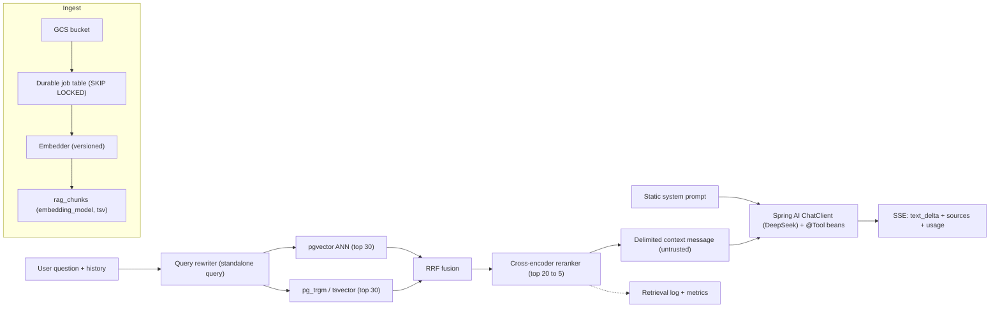

# AI Chat & RAG — Architecture Evaluation

**Date:** 2026-11-22

**Scope:** `com.currencyanalyzer.ai.chat`, `ai.springai`, `ai.knowledge`, `ai.rag`, `storage`

---

## 1. What Works Well

| Area | Assessment |
|---|---|
| **Storage split** | GCS keeps the original files and PostgreSQL holds the derived index. You can rebuild the index at any time (`DELETE` + Sync). |
| **Single runtime store** | Chat history, app data, and vectors all live in one PostgreSQL database—one backup, one set of transactions, and no extra infrastructure to operate. |
| **Tool grounding** | Market numbers come from typed, read-only tools (`AssistantTools`), not from model memory. The prompt forbids inventing prices. |
| **Testability** | `ObjectStorageClient` has a local implementation, `pgvector` detection falls back cleanly to H2, and all 60 tests run offline. |
| **Hybrid retrieval** | Vector + exact-phrase fusion fixed the entity-name failures that a small embedding model cannot handle on its own. |

---

## 2. Risks & Gaps (Prioritized)

### P0: Correctness & Safety

1. **Retrieved documents are injected into the *system* message.**
   `AssistantPrompt.systemMessage` (`src/main/java/com/currencyanalyzer/ai/knowledge/AssistantPrompt.java`) appends chunk text directly to the system prompt. Anyone who can upload a `.md` file can place untrusted text where the model gives it the highest authority, which is a prompt-injection risk.
   - **Fix:** Keep the system prompt static. Pass retrieved chunks as a separate, clearly delimited context message (or tool result) labeled as *untrusted reference material*.

2. **Follow-up questions retrieve the wrong context.**
   `AiConversationService.systemMessage` (`src/main/java/com/currencyanalyzer/ai/chat/AiConversationService.java`) retrieves using only the latest user message. A follow-up like *"what about his risk view?"* lacks the entity name, so retrieval misses.
   - **Fix:** Add a lightweight query-rewrite step that condenses the last few turns into a standalone search query (a short LLM call or rule-based fallback), or rely on the model calling `search_notes` with an explicit query.

3. **Ingestion is not durable.**
   Jobs live only in an in-memory thread pool. If the app restarts mid-sync, documents stay in `PENDING`/`INDEXING` indefinitely.
   - **Fix:** On startup, re-queue rows stuck in `PENDING`/`INDEXING`. Better: claim jobs from a DB table using `SELECT ... FOR UPDATE SKIP LOCKED`.

4. **GCS deletions never reach the index.**
   `syncFromStorage` only adds and updates. A file deleted directly in the GCS bucket continues answering questions from stale `rag_chunks`.
   - **Fix:** During sync, delete `upload` rows under the scanned prefix whose `storage_key` was not returned by GCS.

### P1: Scale & Retrieval Quality

5. **Keyword search loads every chunk on every query.**
   `RagChunkRetriever.search` (`src/main/java/com/currencyanalyzer/ai/rag/RagChunkRetriever.java`) calls `findAllReadyChunks()` and scores them in Java. That is fine for ~1,000 chunks but scales linearly, and parent-document expansion reuses the same full scan.
   - **Fix:** Move lexical search into PostgreSQL:
     - Add `pg_trgm` with a GIN index for CJK and mixed text (no Chinese word segmenter required), or `tsvector` with `zhparser`.
     - Fetch sibling chunks with `WHERE document_id = ANY(?)`.

6. **Scoring relies on hand-tuned constants with no evaluation set.**
   Weights like `0.18`, `-0.08`, `0.45 + score/70 * 0.54`, and stub/changelog multipliers were tuned by hand.
   - **Fix:**
     - Replace score blending with **Reciprocal Rank Fusion (RRF)**, which operates on rank positions and requires no score calibration.
     - Add a **golden evaluation set** of 30–50 questions mapped to expected chunks.
     - Track `Recall@5` and `MRR` in CI so tuning changes are measured objectively.

7. **The embedding model is the main ceiling on retrieval quality.**
   `paraphrase-multilingual-MiniLM-L12-v2` (384-dim, 256-token window) is weak on Chinese finance terminology and cross-lingual matches, which is why the hybrid heuristics were needed.
   - **Fix:** Upgrade to `bge-m3` (local ONNX, 1024-dim, 8k tokens, strong zh/en) or a hosted embedding API, and optionally add a cross-encoder reranker (`bge-reranker-v2-m3`) over the top ~20 candidates. Do this **after** #8 so the migration is zero-downtime.

8. **No embedding version metadata on chunks.**
   Changing the embedding model or vector dimension makes stored vectors silently incompatible.
   - **Fix:** Add `embedding_model` and `embedding_dim` columns to `rag_chunks`, filter searches by the active model, and re-embed in the background.

### P2: Operations & Maintainability

9. **Two chat orchestration paths.**
   `SpringAiChatRunner` (Spring AI `ChatModel`) and the hand-rolled `DeepSeekAiProvider` + `AssistantTools` loop duplicate tool-calling, retries, and thinking-fallback logic.
   - **Fix:** Standardize on Spring AI's `ChatClient` with `@Tool` beans and remove the legacy path once parity tests pass.

10. **No usage limits are enforced.**
    The `ai_usage` table exists (from `V2`), but no service writes to it or enforces quotas.
    - **Fix:** Record token usage per message and enforce per-user daily request and token limits as designed in [AI_ASSISTANT_MODULE.md](./AI_ASSISTANT_MODULE.md).

11. **Citations do not reach the UI, and retrieval is not observable.**
    The model is asked to name note titles in prose, but the UI receives no structured source metadata.
    - **Fix:**
      - Emit an SSE `sources` event with document IDs, chunk indices, and scores, and render clickable citations in the chat drawer.
      - Log each retrieval (query, chunk IDs, scores, latency) and expose Micrometer metrics (`rag_retrieval_seconds`, `rag_hits`).

12. **No per-user access control on documents.**
    Shared workspace access is appropriate for general notes and guides. If personal `journal/` or holdings files are ever indexed, add `visibility` and `owner` columns to `rag_documents` and filter at query time.

13. **Conversation memory has a hard cap.**
    `MAX_CONTEXT_MESSAGES = 20` drops older turns without summarization.
    - **Fix:** Maintain a rolling summary message once conversation history exceeds N turns.

---

## 3. Target Architecture

---

## 4. Suggested Roadmap

| Phase | Items | Effort |
|---|---|---:|
| **1. Hardening** | #1 context out of system prompt · #3 startup re-queue · #4 deletion sync · #10 usage limits | 2–3 days |
| **2. Retrieval quality** | #2 query rewrite · #5 lexical search in PostgreSQL · #6 RRF + golden eval set | 3–4 days |
| **3. Model upgrade** | #8 embedding versioning · #7 `bge-m3` + reranker | 3–5 days |
| **4. UX & ops** | #11 citations + metrics · #9 single chat path · #13 memory summary | 3–4 days |

> **Tip:** Build the golden evaluation set (#6) before upgrading the embedding model (#7) so you can verify quantitatively that `bge-m3` or a reranker beats the current hybrid heuristics.
