# AI Chat & RAG — Architecture Audit & Roadmap

**Initial Review:** 2026-11-22  
**Last Updated:** 2026-11-26 (post PR #20 on `feat/rag-phase1-hardening`)  
**Scope:** `com.currencyanalyzer.ai.chat`, `ai.springai`, `ai.knowledge`, `ai.rag`, `ai.tools`, `storage`, `static/ai-chat.js`

---

## 1. Current Architecture

```mermaid
flowchart LR
    U["User message"] --> S["AiConversationService"]
    S --> GATE["RetrievalIntentGate"]
    GATE -- "skip pure spot/alert" --> LLM["SpringAiChatRunner -> DeepSeek (thinking + 11 tools)"]
    GATE -- "knowledge / follow-up" --> QR["RetrievalQueryRewriter"]
    QR --> KR["KnowledgeRetriever"]
    KR --> RCR["RagChunkRetriever"]
    RCR --> EMB["Bounded ONNX Embed Pool + Caffeine Cache (384-d)"]
    EMB --> V["pgvector HNSW"]
    RCR --> L["pg_trgm word_similarity + ILIKE"]
    V --> F["RRF (k=60) + heuristics + sibling expansion"]
    L --> F
    F --> CTX["UNTRUSTED REFERENCE CONTEXT (max 4 notes, 4000 chars)"]
    KR -. "RAG empty" .-> KL["KnowledgeLibrary fallback"]
    CTX --> LLM
    LLM --> T["11 tools incl. search_notes (deduped via ToolUserContext)"]
    T --> LLM
    LLM --> SSE["SSE (reasoning, tool_started/completed, text_delta) -> ai-chat.js"]
```

**Ingestion pipeline:** Admin upload (`RagDocumentController`) → GCS / local storage (`ObjectStorageClient`) → `TextDocumentParser` (Markdown heading/table/CSV-aware, CJK-weighted token window) → contextual header (`title` + `heading` + `lead`) → MiniLM-L12 ONNX embeddings on a 2-thread platform pool (`RagIngestionService`) → atomic `replaceChunks` guarded by per-document sequence numbers and SHA-256 conditional updates.

---

## 2. What Is Already Strong

| Area | Evidence |
|---|---|
| **Hybrid retrieval** | `pgvector` HNSW cosine search + PostgreSQL `pg_trgm` lexical search combined with rank-based Reciprocal Rank Fusion (`k = 60`) ([RagChunkRetriever.java](file:///c:/Users/cyche/Documents/ChatGPT/currency-analyzer-java/src/main/java/com/currencyanalyzer/ai/rag/RagChunkRetriever.java#L110-L153)) |
| **Contextual chunking** | Title, section heading, and document lead are prepended inside a CJK-weighted 256-token budget so Chinese text is never truncated mid-sentence before embedding ([RagIngestionService.java](file:///c:/Users/cyche/Documents/ChatGPT/currency-analyzer-java/src/main/java/com/currencyanalyzer/ai/rag/RagIngestionService.java#L206-L241), [TextDocumentParser.java](file:///c:/Users/cyche/Documents/ChatGPT/currency-analyzer-java/src/main/java/com/currencyanalyzer/ai/rag/TextDocumentParser.java)) |
| **Ingestion race safety** | Out-of-order async writes and concurrent deletes are prevented via per-document atomic sequence numbers and SHA-256 optimistic SQL guards |
| **Prompt-injection isolation** | Static system prompt separated from retrieved text wrapped in delimited `UNTRUSTED REFERENCE CONTEXT` blocks ([AssistantPrompt.java](file:///c:/Users/cyche/Documents/ChatGPT/currency-analyzer-java/src/main/java/com/currencyanalyzer/ai/knowledge/AssistantPrompt.java)) |
| **Deterministic quant tools** | Live spots, historical series, Ta4j/Hipparchus technicals & correlations, position sizing, and Alerts 2.0 rules run through typed `@Tool` / `AssistantTools` methods instead of LLM guesswork ([MarketQuantAnalytics.java](file:///c:/Users/cyche/Documents/ChatGPT/currency-analyzer-java/src/main/java/com/currencyanalyzer/ai/tools/MarketQuantAnalytics.java)) |
| **Enterprise FinOps & telemetry** | PR #20 shipped historical `reasoning_content` compaction (`P1`), audit metadata (`prompt_version`, `provider_response_id`, `result_summary`), per-user/global concurrency caps & USD circuit breakers (`P2`), Prometheus metrics (`P3`), and Gemini-style tool-chain UI |
| **Retrieval quality gate** | 30-query bilingual EN/ZH golden set asserting `Recall@5 >= 0.90` and `MRR >= 0.80` ([RagRetrievalEvaluationTests.java](file:///c:/Users/cyche/Documents/ChatGPT/currency-analyzer-java/src/test/java/com/currencyanalyzer/ai/rag/RagRetrievalEvaluationTests.java)) |

---

## 3. Audit Findings (2026-11-26)

Severity: **High** · **Medium** · **Low**

### 3.1 Retrieval Pipeline

| # | Severity | Finding | Why It Matters | Status |
|---|---|---|---|---|
| **R1** | Medium | **Small chunks with ~50% overlap (`155` max / `80` overlap) & misnamed config `chunk-max-chars`.** | Roughly 2× chunk count/index footprint, fragmented answers, and reliance on `expandStrongDocuments` heuristics; `chunk-max-chars` actually limits tokens. | **Addressed in Phase 1** (`chunk-max-tokens: 155`, `chunk-overlap-tokens: 28`) |
| **R2** | Medium | **Hand-tuned ranking magic constants** (`0.70`, `0.18`, `×0.60`, `×0.80`, `+42/+30/+12`, `0.45 + score/70*0.54`). | Tuned to the initial corpus and fragile as document volume grows without a learned relevance model. | Open (Phase 2) |
| **R3** | Medium | **Mixed score semantics** (cosine similarity, normalized RRF, and scaled lexical scores share the single `similarityThreshold` cutoff). | `0.45` represents three incompatible scales across code paths. | Open (Phase 2) |
| **R4** | Medium | **No cross-encoder reranker.** | Top-k depends purely on bi-encoder/lexical fusion and heuristics rather than pairwise query–chunk semantic scoring. | Open (Phase 2) |
| **R5** | Low | **Dated 2021 embedding model** (`paraphrase-multilingual-MiniLM-L12-v2`, 384-d) with no `embedding_model` column on `rag_chunks`. | Weaker financial domain terminology and mixed ZH/EN semantics; zero-downtime re-embedding requires model/dimension metadata on chunks. | Open (Phase 2) |
| **R6** | Low | **Lexical search is trigram + `ILIKE`, not BM25.** | `word_similarity` + `ILIKE ANY` re-scored in Java over 60 rows lacks IDF weighting and slows down at thousands of documents. | Open (Phase 3) |
| **R7** | Low | **Post-filtered HNSW JOIN** (`WHERE d.status = 'READY' AND similarity >= ?`). | Filtering after ANN graph traversal can under-fill `LIMIT` as filtered categories grow (`hnsw.ef_search` / `pgvector` `iterative_scan` needed at scale). | Open (Phase 3) |
| **R8** | Low | **Regex-only follow-up query rewriting** in `RetrievalQueryRewriter`. | Misses ellipses (*"and for gold?"*) or mixed-language follow-ups. | Open (Phase 3) |

### 3.2 Orchestration & Agent

| # | Severity | Finding | Why It Matters | Status |
|---|---|---|---|---|
| **A1** | Medium | **Redundant double retrieval.** Pre-retrieval ran unconditionally on every turn (including *"What is EUR/USD now?"*) and `search_notes` could return already-attached chunks. | Wastes prompt tokens, ONNX CPU, and context space. | **Addressed in Phase 1** (`RetrievalIntentGate` + `ToolUserContext` dedup) |
| **A2** | Medium | **Query ONNX embedding ran on the request's virtual thread with no cache.** | Violates the AGENTS.md rule against running CPU/JNI inference on unbounded virtual threads; repeated queries re-computed embeddings. | **Addressed in Phase 1** (2-thread platform pool + Caffeine cache) |
| **A3** | Medium | **`LazyTransformersEmbeddingModel.ready` was non-`volatile` in DCL.** | Under the Java Memory Model, another thread could observe `ready == true` before `afterPropertiesSet()` completed. | **Addressed in Phase 1** (`volatile boolean ready`) |
| **A4** | Medium | **Two agent loops** (`SpringAiChatRunner` and legacy `AiProvider` tool loop in `AiConversationService`). | Shared concerns (DSML sanitization, retries, tool caps) must be maintained twice and can drift. | Open (Phase 3) |
| **A5** | Medium | **Prompt-only guard on mutating alert tools** (`create_alert_rule`, `update_alert_rule_status`). | Uploaded documents or adversarial tool outputs are mitigated by instructions today rather than a server-side confirmation token / UI step. | Open (Phase 3) |
| **A6** | Low | **Hard 20-message context cutoff (`MAX_CONTEXT_MESSAGES = 20`).** | Long conversations lose earlier decisions instead of using rolling summaries. | Open (Phase 3) |
| **A7** | Low | **Sequential multi-tool execution within a round.** | Independent tool calls (e.g., multiple pairs) serialize latency. | Open (Phase 3) |

### 3.3 Grounding, Evaluation & Observability

| # | Severity | Finding | Why It Matters | Status |
|---|---|---|---|---|
| **E1** | Medium | **No structured citations.** Prompts ask the model to name the document title, with no numbered markers or clickable UI source chips. | Users cannot verify grounding chunk-by-chunk, and citation precision is unmeasured. | Open (Phase 2) |
| **E2** | Medium | **CI evaluation tests lexical-only H2 retrieval**, without pgvector evaluation or answer faithfulness grading. | Vector/RRF regressions and hallucinated claims are invisible in automated CI. | Open (Phase 2) |
| **E3** | Low | **No RAG retrieval metrics/traces or user feedback signal.** | Difficult to measure cache hit rate, empty retrievals, or latency vs DeepSeek latency. | **Metrics addressed in Phase 1** (`AiMetrics` RAG metrics); traces/feedback in Phase 3 |
| **E4** | Low | **Single DeepSeek provider without Resilience4j circuit breaker or fallback.** | Upstream outages fail all turns instead of degrading gracefully or routing simple queries. | Open (Phase 3) |
| **E5** | Low | **Corpus-global retrieval SQL (no per-user ACL).** | Safe while uploads are admin-only (`KnowledgeAdminService`), but must be partitioned before supporting private per-user documents. | Deferred until multi-tenant uploads |

---

## 4. Phased Direction & Roadmap

### Phase 1 — Quick Wins *(Implemented on `feat/rag-phase1-hardening`)*
1. **A3:** Mark `LazyTransformersEmbeddingModel.ready` `volatile`.
2. **A2:** Execute query ONNX embeddings on a dedicated 2-thread bounded platform pool (`rag-query-embed`) with a 10s timeout and a Caffeine cache (`1,000` queries, `10m` TTL).
3. **A1:** Gate pre-retrieval on conservative intent classification (`RetrievalIntentGate`) to skip pure spot/indicator/alert operational turns, and deduplicate already-attached `KnowledgeNote` IDs inside `AssistantTools.searchNotes` via `ToolUserContext`.
4. **R1:** Rename chunk config properties to `app.rag.chunk-max-tokens` (`155`) and `app.rag.chunk-overlap-tokens` (`28`, ~18% overlap), preserving fallback support for legacy `chunk-max-chars` / `chunk-overlap-chars`.
5. **E3:** Expose `currency_analyzer_rag_retrieval_seconds`, `currency_analyzer_rag_hits`, `currency_analyzer_rag_empty_total`, `currency_analyzer_rag_embedding_total`, and `currency_analyzer_rag_embedding_seconds` on `/metrics` and `/actuator/prometheus`.

#### 4.1 Token Economics of Pre-Retrieval Gating (~20–40% Savings on Operational Turns)

Tool-using turns execute at least **two** model calls inside `SpringAiChatRunner` (Round 1: tool selection; Round 2: answer synthesis). Before Phase 1, unconditional pre-retrieval routinely matched generic terms (`EUR/USD`, `rate`, `alert`) against guides and injected `500–1,200` tokens of `UNTRUSTED REFERENCE CONTEXT` that stayed in the prompt for **every round**—billing `1,000–2,400` unnecessary tokens against a `~3,850`-token 2-round baseline (**~21%–38%** total input overhead). Skipping pre-retrieval via `RetrievalIntentGate` on pure operational turns (while retaining on-demand `search_notes` and deduplicating attached `KnowledgeNote.path()` IDs through `ToolUserContext`) eliminates that repeated multi-round tax without losing recall on hybrid queries.

### Phase 2 — Retrieval & Answer Quality *(Deferred — RAG Frozen at Phase 1)*
1. **Cross-encoder reranker (R4 + R2 + R3):** Score the top 20–24 RRF candidates using `bge-reranker-v2-m3` (local ONNX or hosted rerank API) and calibrate the cutoff on reranker scores, retiring brittle magic boosts.
2. **Parent/child small-to-big chunking (R1):** Index small child chunks (~150 tokens) for high-precision matching while injecting their parent section (~600–900 tokens) into prompt context, replacing `expandStrongDocuments`.
3. **Versioned embedding upgrade (R5):** Add `embedding_model VARCHAR(128)` and `embedding_dim INTEGER` to `rag_chunks` (portable migration + PostgreSQL vector index migration) and benchmark `multilingual-e5-small` vs `bge-m3` against the golden set.
4. **End-to-end citations (E1):** Number injected context blocks `[1]..[n]`, instruct inline citations, emit an SSE `citations` event, persist citations on `ai_messages`, and render clickable source chips in `ai-chat.js`.
5. **Real `pgvector` eval in CI (E2):** Run `RagRetrievalEvaluationTests` against PostgreSQL + `pgvector` (Testcontainers) and report vector-only, lexical-only, and hybrid Recall@5 / MRR / nDCG@5.

### Phase 3 — Enterprise Agent Platform *(Deferred / Re-scoped into Master-as-Code Milestones)*
1. **Single agent loop (A4):** Deprecate and remove the duplicate non-Spring-AI tool loop in `AiConversationService` / `DeepSeekAiProvider`.
2. **Human-in-the-loop mutations (A5):** Have `create_alert_rule` and `update_alert_rule_status` return a server-persisted pending confirmation token with UI Confirm/Cancel buttons so LLM tool calls never execute state mutations unilaterally *(scheduled in Milestone 3 of the Master-as-Code roadmap)*.
3. **Rolling memory & follow-up rewrite (A6, R8):** Persist rolling conversation summaries once threads exceed ~16 turns and optionally run lightweight non-thinking follow-up condensation when `isFollowUp()` triggers.
4. **End-to-end tracing, eval & provider resilience (E2–E4, R6–R7):** Add OpenTelemetry spans (`retrieve -> rerank -> llm -> tools`), offline LLM-as-judge faithfulness/citation evaluation, user thumbs-up/down feedback, Resilience4j circuit breakers + fallback routing, and BM25 / `hnsw.ef_search` tuning when corpus size exceeds ~5,000 docs.

---

## 5. Resolved Product Decisions (2026-11-26 — "Master-as-Code" Pivot)

1. **Two-Store Split (Scenario SOPs in RAG vs. Post-Close Incremental SQL for Market Data):** Raw RAG over trading books mixes conflicting opinions, and chunking `.csv` tables into `pgvector` breaks numeric queries. `.csv` parsing is removed from RAG (`.md` / `.txt` only); RAG is intentionally frozen at Phase 1 strictly for system documentation (`knowledge/guides/`), 1-page **Vetted Strategy Cards** (`knowledge/strategies/`), and conflict-free **Desk Scenario Runbook SOPs** (`knowledge/scenarios/`), while tabular OHLC & policy-rate data live in relational PostgreSQL (`ohlc_history` / `policy_rate_history`) updated via post-NY-5pm incremental delta loading (`IncrementalOhlcSyncService`).
2. **5-Stage Carver/AQR Benchmark Spine + Master Arena:** Trading methodologies are compiled into pluggable Stage 2 (`SignalEngine`) and Stage 3 (`PortfolioRiskSizer` / `RegimeRiskOverlay`) Java interfaces via [distill-master-module/SKILL.md](../.agents/skills/distill-master-module/SKILL.md) and falsified with Spot-vs-Carry attribution and crisis replay before entering production target sheets.
3. **Deferred Phase 2 RAG Constraints (Preserved if Reactivated Later):** Should Phase 2 RAG ever be resumed for large multi-user corpora, it will use a pluggable hosted API primary (Vertex AI Ranking/Embeddings or HTTP `bge-m3` / `bge-reranker-v2-m3`) with local ONNX fallback, and add `visibility` (`'SHARED' | 'PRIVATE'`) + `owner_username` filtering on `rag_documents`.

See [TRADING_WORKSTATION_ROADMAP.md](TRADING_WORKSTATION_ROADMAP.md) for the full 4-milestone execution plan covering the 5-stage pure-Java pipeline, Paper Trade & Live Master Target Sheet, Discretionary-vs-Master Skills, and the Spring AI `/mcp` server.

---

## 6. Enterprise Agent & RAG Design Principles (Reference Guide)

These ten engineering principles synthesize modern production Agent & RAG practices (Anthropic "Building Effective Agents", OpenAI practical agent guidelines, OWASP Top 10 for LLM Applications, and two-stage RAG architectures) and map each directly onto `currency-analyzer-java`.

### Architecture & Context Engineering
1. **Deterministic Workflows First; Bounded Agent Loops Where Needed:** Do not delegate deterministic calculations or state checks to probabilistic LLM tokens when code or typed tools are cheaper, faster, and exact. Compute indicators, correlations, and position sizing deterministically (`Ta4j` + `Hipparchus`), and strictly bound agent autonomy (`MAX_TOOL_ROUNDS = 3`, `MAX_TOOL_CALLS_PER_ROUND = 4`).
2. **Adaptive & Agentic Retrieval Over Blind "Always-On" Context Stuffing:** Never blindly pre-inject top-k chunks on every turn. In multi-round tool loops, pre-injected text is re-billed on every round and dilutes model attention. Gate pre-retrieval (`RetrievalIntentGate`), expose retrieval as an explicit tool (`search_notes`), and deduplicate already-attached chunks per turn (`ToolUserContext`).
3. **Multi-Turn Context Hygiene & Lean Tool Surfaces:** Keep tool schemas small, orthogonal, and non-overlapping (11 focused tools after retiring 4 overlapping legacy tools). Strip historical `reasoning_content` across completed turns (`~30–60%` token savings), cap serialized tool outputs, and summarize long histories rather than overflowing context windows.

### Retrieval & Data Lifecycle
4. **Two-Stage Hybrid Retrieval (Broad Recall -> Cross-Encoder Rerank):** Combine semantic bi-encoder search (`pgvector`) with lexical search (BM25 / `pg_trgm`) via Reciprocal Rank Fusion (`RRF`) for high recall, then calibrate precision with a cross-encoder reranker instead of maintaining brittle magic-number thresholds (`0.70`, `×0.60`, `+42`) across incompatible score scales.
5. **Chunk for Retrieval, Expand for Generation ("Small-to-Big" + Contextual Headers):** Bi-encoder embeddings are sharpest on concise, contextually anchored chunks (`title + heading + lead` within CJK-weighted token budgets), whereas LLMs synthesize better from fuller parent sections (~600–900 tokens). Prefer parent-child mapping and low (~15–20%) chunk overlap over ~50% overlap and ad-hoc sibling heuristics.
6. **Derived, Versioned, Race-Safe Indexing:** Treat object storage (`GCS`) as the immutable source of truth and vector/chunk tables as rebuildable derived indexes. Guard async ingestion against out-of-order writes and deletes (`sequence` + SHA-256 conditional SQL updates), and store `embedding_model` + `embedding_dim` on chunks so model upgrades can backfill zero-downtime.

### Safety, Infrastructure Ops & Evaluation
7. **Defense-in-Depth Against Indirect Prompt Injection & Excessive Agency (OWASP LLM01 / LLM06):** Isolate retrieved text and tool output outside the `system` prompt inside untrusted delimiters, bind user identity (`ToolUserContext`) server-side from the authenticated session (never from LLM arguments), and gate state-mutating tools behind server-persisted confirmation steps rather than prompt instructions alone.
8. **Compute Isolation & FinOps Circuit Breakers:** Keep CPU/JNI inference (local ONNX embeddings/rerankers) on small bounded platform thread pools plus LRU caches—never on unbounded virtual threads alongside DB/HTTP traffic. Enforce per-user and global active-stream caps, in-flight quota checks, and daily USD spend circuit breakers at the service boundary.
9. **Verifiable Grounding & Structured Citations:** Every quantitative figure in an answer should trace to a live tool payload (`as_of` timestamp / series dates), and every knowledge claim should trace to a numbered source chunk (`[1]`, `[2]`) exposed in the UI with source links—never relying solely on free-text titles.
10. **Evaluation-Driven Iteration (Offline Benchmarks + Online Telemetry):** Gate retrieval changes with automated bilingual golden sets (`Recall@k`, `MRR`, `nDCG` under real vector + lexical engines) and LLM-as-judge faithfulness/citation checks, paired with live Prometheus observability (`TTFT`, token cost, cache hit rate, empty-retrieval rate, and DSML recovery count).
