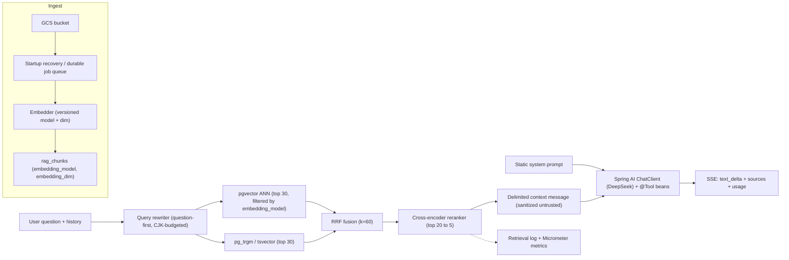

# AI Chat & RAG — Architecture Evaluation & Execution Plan

**Initial Review:** 2026-11-22  
**Last Updated:** 2026-11-23 (baseline commit `b4f553c` on `cursor/knowledge-agent-2fe5`)  
**Scope:** `com.currencyanalyzer.ai.chat`, `ai.springai`, `ai.knowledge`, `ai.rag`, `storage`

---

## 1. What Works Well

| Area | Assessment |
|---|---|
| **Storage split** | GCS keeps the original files and PostgreSQL holds the derived index. You can rebuild the index at any time (`DELETE` + Sync). |
| **Single runtime store** | Chat history, app data, and vectors all live in one PostgreSQL database—one backup, one set of transactions, and no extra infrastructure to operate. |
| **Tool grounding** | Market numbers come from typed, read-only tools (`AssistantTools` / `SpringAiMarketTools`), not from model memory. The prompt forbids inventing prices. |
| **Testability** | `ObjectStorageClient` has a local implementation, `pgvector` and `pg_trgm` detection fall back cleanly to H2, and all **96 tests** run offline (`SonarCloud` Quality Gate `OK`, `82.1%` new-code coverage). |
| **Hybrid retrieval + RRF** | Vector search (`pgvector` HNSW) + PostgreSQL `pg_trgm` lexical search + Reciprocal Rank Fusion (`k = 60`) + targeted sibling lookup by document ID (`WHERE d.id IN (:documentIds)`). |
| **Hardening** | Static system prompt with delimited untrusted reference context, follow-up query rewriting, per-user daily usage metering, startup recovery of stuck docs, and bucket-scoped GCS deletion pruning. |

---

## 2. Roadmap Status (as of `b4f553c`)

| # | Priority | Item | Status | Notes / Remaining Gaps |
|---|---|---|---|---|
| 1 | P0 | Retrieved notes out of the system prompt | **Done (1 gap)** | **Gap A:** `AssistantPrompt.referenceContext` does not sanitize literal `UNTRUSTED REFERENCE CONTEXT` / `END UNTRUSTED REFERENCE CONTEXT` lines inside uploaded documents. |
| 2 | P0 | Rewrite follow-up questions | **Done (1 bug)** | **Gap B:** `RetrievalQueryRewriter` prepends prior turns before the question up to 800 chars, which can truncate a Chinese follow-up past MiniLM's 256-token cap; Chinese follow-up detection only matches `[他她它其]`. |
| 3 | P0 | Durable ingestion & startup re-queue | **Done (basic)** | Startup recovery (`RagStartupSyncRunner` + `recoverStuckDocuments`) is live. Durable DB job queue (`SELECT ... FOR UPDATE SKIP LOCKED`) is optional future work for multi-instance deployments. |
| 4 | P0 | Remove index rows for files deleted from GCS | **Done** | `pruneDeletedUploads` reconciles deleted objects, guarded by bucket match and non-empty listing check. |
| 5 | P1 | Lexical search & sibling lookup in PostgreSQL | **Done (caveat)** | `V7__rag_pg_trgm.sql` + `searchLexicalCandidates` + `findReadyChunksByDocumentIds`. **Caveat D:** verify DB locale is UTF-8 (not `C`) for `pg_trgm` CJK indexing; 2-char CJK `ILIKE` terms do not use the GIN trigram index. |
| 6 | P1 | Rank fusion (RRF) + golden eval set | **Done (caveat)** | `fuseWithRrf` (`k = 60`) + 30-query bilingual `RagRetrievalEvaluationTests` (`Recall@5 >= 0.90`, `MRR >= 0.80`). **Caveat E:** eval currently runs on H2 lexical-only and checks filename rather than chunk ID. |
| 7 | P1 | Upgrade embedding model (`bge-m3`) + reranker | **Open** | **Blocked on #8** so vector dimension changes (`384 -> 1024`) are zero-downtime. |
| 8 | P1 | Embedding version metadata on chunks | **Open** | **Next major milestone** after closing Gaps A–C. |
| 9 | P2 | Consolidate to one chat orchestration path | **Open** | Remove legacy `DeepSeekAiProvider` + `AssistantTools` loop once `SpringAiChatRunner` reaches full parity. |
| 10 | P2 | Enforce usage limits (`ai_usage`) | **Done (gaps)** | **Gap C:** limits default to `0` (disabled); `retryWithoutThinking` is uncounted; "requests" counts model calls rather than user messages; concurrent chats can soft-overshoot. |
| 11 | P2 | Structured SSE `sources` citations + retrieval metrics | **Open** | Emit `sources` SSE event to `ai-chat.js` and add Micrometer timers/counters (`rag_retrieval_seconds`, `rag_hits`). |
| 12 | P2 | Per-user document access control | **Deferred** | Not needed while the corpus contains only shared guides and notes; revisit before indexing personal `journal/` or holdings files. |
| 13 | P2 | Rolling summary of long conversations | **Open** | `MAX_CONTEXT_MESSAGES = 20` currently drops older turns without summarization. |

---

## 3. Target Architecture

---

## 4. Direction & Execution Plan (Handoff Packages)

Execute the remaining work in **4 sequential workstreams** so each PR stays small, testable, and safe to ship independently.

### Workstream 1 — Close Phase 1–2 Gaps (A, B, C) *(Immediate — 0.5 day)*

Fix the three concrete gaps found in the `b4f553c` review before adding new features:

1. **Sanitize untrusted context delimiters (Gap A)**
   - **File:** `src/main/java/com/currencyanalyzer/ai/knowledge/AssistantPrompt.java`
   - **Change:** Strip or neutralize literal `UNTRUSTED REFERENCE CONTEXT` and `END UNTRUSTED REFERENCE CONTEXT` lines inside note titles and excerpts before wrapping in `referenceContext(...)`.
   - **Test:** Add a prompt-injection test in `KnowledgeRetrieverTests` verifying an adversarial note containing `END UNTRUSTED REFERENCE CONTEXT` cannot break out of the block.

2. **Question-first, CJK-budgeted query rewriter (Gap B)**
   - **File:** `src/main/java/com/currencyanalyzer/ai/knowledge/RetrievalQueryRewriter.java`
   - **Change:**
     - Place the **latest user question first** (`question + "\n" + prior`), then append trimmed prior context within a CJK-weighted token budget (`<= 220` estimated tokens so MiniLM's 256-token window never drops the question).
     - Expand Chinese follow-up detection beyond `[他她它其]` to include common short follow-ups (`那`, `这`, `该`, trailing `呢`/`吗`, and short queries `<= 12` CJK chars).
   - **Test:** Add unit tests covering long Chinese prior turns + short Chinese follow-up (`风险呢？`, `那为什么？`) asserting the rewritten query keeps the question intact and stays under the token cap.

3. **Close usage-metering gaps (Gap C)**
   - **Files:** `src/main/java/com/currencyanalyzer/ai/chat/AiConversationService.java`, `src/main/java/com/currencyanalyzer/ai/chat/AiUsageService.java`, `src/main/resources/application.yml`, `compose.yaml`
   - **Change:**
     - Route `retryWithoutThinking(...)` through `aiProvider.consume(...)` and record its usage in `UsageLedger` (so retries cannot bypass quotas).
     - Clarify and align request counting semantics (prefer counting **user messages** as `1` request per `streamMessage` while summing all round tokens, or rename to `daily-model-call-limit`).
     - Document soft-limit behavior under concurrent conversations and set sensible non-zero defaults in `compose.yaml` while keeping `0` in test `application.yml`.
   - **Test:** Add a test in `AiConversationControllerTests` verifying `retryWithoutThinking` increments `ai_usage`.

---

### Workstream 2 — Embedding Versioning & Model Upgrade (#8 → #7) *(3–5 days)*

Do **#8 first**, then **#7**, so migrating from 384-dim MiniLM to 1024-dim `bge-m3` (or hosted embeddings) is zero-downtime.

1. **#8 — Embedding version metadata**
   - **Migrations:**
     - `src/main/resources/db/migration/V8__rag_embedding_metadata.sql`: add `embedding_model VARCHAR(128)` and `embedding_dim INTEGER` columns to `rag_chunks` (portable H2 + PostgreSQL DDL).
     - Keep any PostgreSQL-only vector column/index changes in `src/main/resources/db/postgresql-migration/` (guarded by `pg_available_extensions`).
   - **Files:** `RagDocumentRepository.java`, `RagIngestionService.java`, `LazyTransformersEmbeddingModel.java`, `application.yml`
   - **Change:**
     - Persist active `embedding_model` + `embedding_dim` when writing chunks.
     - Filter `searchByVector(...)` by `WHERE c.embedding_model = ? AND c.embedding_dim = ?` so mismatched vectors are never compared.
     - On startup (or via admin re-index), detect ready documents whose chunks have a stale `embedding_model` and re-queue them asynchronously in the background.
   - **Test:** Verify mixed-model chunks only return matches for the active model, and stale-model documents are detected for background re-embedding.

2. **#7 — Upgrade embedding model + optional reranker + vector eval**
   - **Pre-step (Caveat E):** Extend `RagRetrievalEvaluationTests` with a real-embedding (or PostgreSQL Testcontainers) benchmark profile that asserts **chunk-level** `Recall@5` and `MRR` on the 30+ query golden set.
   - **Change:** Add configurable support for `bge-m3` (1024-dim, 8k window) or hosted embedding API, and optionally add a cross-encoder reranker (`bge-reranker-v2-m3`) over the top 20 RRF candidates.
   - **Gate:** Only promote the new model as default once it beats the MiniLM baseline on the golden evaluation set.

---

### Workstream 3 — Citations, Observability & Chat Consolidation (#11, #9) *(3–4 days)*

1. **#11 — Structured SSE `sources` + Micrometer metrics**
   - **Backend:** `AiConversationService.java`, `RagChunkRetriever.java`
     - Emit a structured SSE `sources` event (`[{documentId, title, filename, chunkIndex, heading, score}]`) when context is attached.
     - Record Micrometer metrics (`rag_retrieval_seconds`, `rag_hits`, `rag_fallback_total`) and structured debug logs (latency, hit count, top score — never logging raw user prefix/PII).
   - **Frontend:** `src/main/resources/static/ai-chat.js`
     - Render clickable citation chips below each assistant answer linking to the document preview/download.

2. **#9 — Consolidate to a single chat orchestration path**
   - **Files:** `SpringAiChatRunner.java`, `AiConversationService.java`, `DeepSeekAiProvider.java`, `AssistantTools.java`
   - **Change:** Verify full feature parity in `SpringAiChatRunner` (streaming, reasoning, tool calling, usage metering, truncation continuation), migrate remaining tests, and remove the duplicate `DeepSeekAiProvider` tool-calling loop.

---

### Workstream 4 — Conversation Memory & Operational Polish (#13, #3-durable, #12) *(As needed)*

1. **#13 — Rolling conversation summary:** When a conversation exceeds 20 messages, summarize older turns into a stored summary row on `ai_conversations` instead of silently dropping history.
2. **#3 (multi-instance durability):** If scaling beyond one app instance, move ingestion dispatch from the in-memory fixed thread pool to a DB-backed job table claimed with `SELECT ... FOR UPDATE SKIP LOCKED`.
3. **#12 — Per-user document ACL:** Only if personal `journal/` or holdings files are added to RAG, add `visibility` (`shared` / `private`) and `owner_username` to `rag_documents` and enforce the filter in every retrieval SQL query.

---

## 5. Verification Gate for Every Workstream

Every implementing agent/model must satisfy all checks before pushing:
1. Run `.\mvnw.cmd -o clean verify` on JDK 25 (`0` failures/errors).
2. Confirm JaCoCo new-code coverage is comfortably `>= 80%` (aim for `>= 83%` on modified packages).
3. Keep PostgreSQL-only DDL (`pgvector`, `pg_trgm`, GIN/HNSW) strictly inside `src/main/resources/db/postgresql-migration/`.
4. Use static SQL constants (`NamedParameterJdbcTemplate` or fixed placeholders) to avoid Sonar `java:S2077`.
5. Confirm GitHub CI (`verify`, `SonarCloud Code Analysis`, `qodana`) all complete green.
