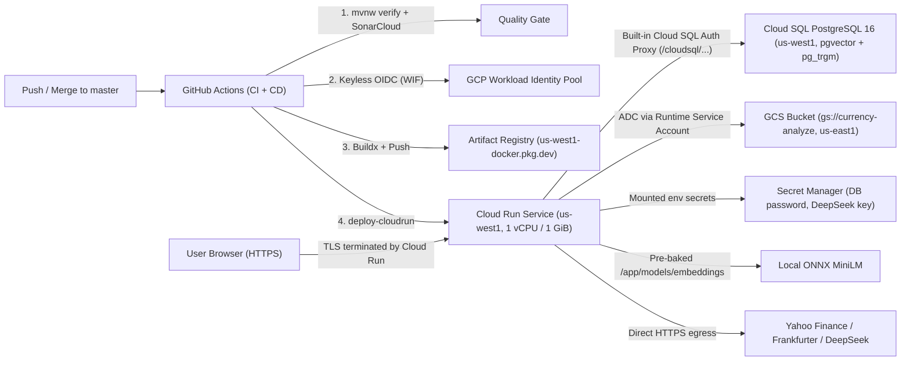

# GCP Cloud Run, Cloud SQL & CI/CD Deployment Plan

**Date:** 2026-11-23  
**Project ID:** `project-3806d7a4-0bd7-416f-8c4`  
**Compute & DB Region:** `us-west1` (Oregon — co-located with existing Cloud SQL instance `project-3806d7a4-0bd7-416f-8c4:us-west1:currency-analyzer` for `<1ms` DB socket latency)  
**Storage Bucket:** `gs://currency-analyze` (`us-east1` Standard, Public access: Not public, Protection: Soft Delete)  
**Repository:** `cychengming/currency-analyzer-java`  

---

## 1. CI/CD Decision: GitHub Actions vs. Jenkins

**Recommendation: Use GitHub Actions — do not provision Jenkins.**

| Criterion | GitHub Actions (Recommended) | Jenkins |
|---|---|---|
| **Meets all deployment requirements?** | **Yes** — Java 25 build/test, SonarCloud gate, Docker Buildx build, Artifact Registry push, Cloud Run deploy, readiness smoke test, and production approval gates. | Yes, but with high operational overhead. |
| **Existing foundation** | Already running in [.github/workflows/ci.yml](file:///c:/Users/cyche/Documents/ChatGPT/currency-analyzer-java/.github/workflows/ci.yml) on Temurin Java 25. | Requires provisioning, hardening, and maintaining a separate Jenkins controller VM/GKE cluster. |
| **GCP authentication** | **Keyless OIDC** via Workload Identity Federation (`google-github-actions/auth@v2`) — no long-lived JSON keys to store or rotate. | Usually requires managing service-account key secrets or custom OIDC/WIF plugins. |
| **Cost & operations** | \$0 on public repositories (generous free minutes on private repos); zero server maintenance. | Always-on VM/GKE billing + plugin & OS security patching. |
| **Manual approval gate** | Built-in via GitHub **Environments** (`production` required reviewers) + `workflow_dispatch`. | Requires pipeline `input` steps and Jenkins RBAC setup. |

*Only adopt Jenkins if an enterprise policy mandates building inside a private on-premises or VPC network that GitHub-hosted runners cannot reach.*

---

## 2. Target GCP Architecture



> [!NOTE]
> Co-locating **Cloud Run + Artifact Registry in `us-west1`** alongside your existing Cloud SQL instance keeps every SQL/pgvector query sub-millisecond over the local Auth Proxy socket, while Cloud Run reads `gs://currency-analyze` (`us-east1`) cleanly via ADC.

---

## 3. Codebase Gaps & Implemented Repository Changes

Inspecting [pom.xml](file:///c:/Users/cyche/Documents/ChatGPT/currency-analyzer-java/pom.xml), [application.yml](file:///c:/Users/cyche/Documents/ChatGPT/currency-analyzer-java/src/main/resources/application.yml), [Dockerfile](file:///c:/Users/cyche/Documents/ChatGPT/currency-analyzer-java/Dockerfile), and [LazyTransformersEmbeddingModel.java](file:///c:/Users/cyche/Documents/ChatGPT/currency-analyzer-java/src/main/java/com/currencyanalyzer/ai/knowledge/LazyTransformersEmbeddingModel.java) identified five items to prepare in the repository before deploying to Cloud Run:

### 3.1 Cloud SQL JDBC Socket Factory (`pom.xml`)

Cloud Run provides a built-in Cloud SQL Auth Proxy Unix domain socket at `/cloudsql/<PROJECT>:<REGION>:<INSTANCE>`, eliminating public IP whitelisting and paid Serverless VPC Access connectors. Standard `org.postgresql:postgresql` needs the Cloud SQL Socket Factory on the runtime classpath to dial that socket.

#### [MODIFY] `pom.xml`
Add inside `<dependencies>`:
```xml
<dependency>
    <groupId>com.google.cloud.sql</groupId>
    <artifactId>postgres-socket-factory</artifactId>
    <version>1.28.4</version>
    <scope>runtime</scope>
</dependency>
```

### 3.2 HTTPS Forwarded Headers (`src/main/resources/application.yml`)

Cloud Run terminates TLS at Google's frontend and forwards `X-Forwarded-Proto: https` and `X-Forwarded-For` to the container. Enabling `forward-headers-strategy: framework` lets Spring Boot / Spring Security issue `Secure` session cookies properly when `SESSION_COOKIE_SECURE=true`.

#### [MODIFY] `src/main/resources/application.yml`
Under `server:`, add `forward-headers-strategy: framework`:
```yaml
server:
  port: ${PORT:5000}
  forward-headers-strategy: framework
  shutdown: graceful
```
*(Existing `PORT`, `DATABASE_POOL_SIZE`, `SESSION_COOKIE_SECURE`, `STORAGE_PROVIDER=gcs`, and Flyway `db/migration` + `db/postgresql-migration` properties already support Cloud Run.)*

### 3.3 Docker Build Context Hygiene (`.dockerignore`)

#### [NEW] `.dockerignore`
Prevent sending local git history, build outputs, docs, and agent metadata into Docker builds:
```gitignore
.git
.github
.agents
.idea
.vscode
target
docs
*.md
compose.yaml
Dockerfile
.dockerignore
```

### 3.4 Multi-Stage Cloud Run `Dockerfile`

Current [Dockerfile](file:///c:/Users/cyche/Documents/ChatGPT/currency-analyzer-java/Dockerfile) now uses pinned `eclipse-temurin:25-jdk-noble` / `eclipse-temurin:25-jre-noble` (Ubuntu 24.04 LTS), zero `apt-get` calls, Java 25 `HttpClient` to pre-bake the ~130 MB MiniLM ONNX + tokenizer files (`ARG PREBAKE_EMBEDDING_MODEL=true`), non-root UID `10001` (`currency`), `ENV PORT=8080`, `ENV MALLOC_ARENA_MAX=2`, and `-XX:MaxRAMPercentage=45.0 -XX:+ExitOnOutOfMemoryError`. On the pinned 1 GiB Cloud Run limit that heap cap is about 460 MiB, leaving the rest for ONNX Runtime native memory, Metaspace, and glibc.

```dockerfile
# syntax=docker/dockerfile:1
FROM eclipse-temurin:25-jdk-noble AS build
WORKDIR /workspace

COPY .mvn .mvn
COPY mvnw mvnw
COPY pom.xml pom.xml
RUN chmod +x mvnw \
  && ./mvnw -B -ntp dependency:resolve

COPY src src
RUN ./mvnw -B -ntp -DskipTests package

FROM eclipse-temurin:25-jdk-noble AS model-fetch
ARG PREBAKE_EMBEDDING_MODEL=true
WORKDIR /models/embeddings
COPY <<'EOF' /tmp/Fetch.java
import java.net.URI;
import java.net.http.HttpClient;
import java.net.http.HttpRequest;
import java.net.http.HttpResponse;
import java.nio.file.Path;

public class Fetch {
    public static void main(String[] args) throws Exception {
        HttpClient client = HttpClient.newBuilder()
            .followRedirects(HttpClient.Redirect.NORMAL)
            .build();
        for (int i = 0; i < args.length; i += 2) {
            HttpRequest request = HttpRequest.newBuilder(URI.create(args[i])).GET().build();
            HttpResponse<Path> response = client.send(request, HttpResponse.BodyHandlers.ofFile(Path.of(args[i + 1])));
            if (response.statusCode() < 200 || response.statusCode() >= 300) {
                throw new RuntimeException("HTTP " + response.statusCode() + " for " + args[i]);
            }
        }
    }
}
EOF
RUN if [ "$PREBAKE_EMBEDDING_MODEL" = "true" ]; then \
      java /tmp/Fetch.java \
        "https://huggingface.co/Xenova/paraphrase-multilingual-MiniLM-L12-v2/resolve/main/onnx/model_quantized.onnx" "model_quantized.onnx" \
        "https://huggingface.co/Xenova/paraphrase-multilingual-MiniLM-L12-v2/resolve/main/tokenizer.json" "tokenizer.json"; \
    fi

FROM eclipse-temurin:25-jre-noble
WORKDIR /app
RUN useradd --system --uid 10001 --create-home currency \
  && mkdir -p /app/models/embeddings
COPY --from=build /workspace/target/currency-analyzer-java-*.jar /app/app.jar
COPY --from=model-fetch /models/embeddings /app/models/embeddings
RUN chown -R currency:currency /app
USER currency
ENV MALLOC_ARENA_MAX=2
ENV PORT=8080
EXPOSE 8080
ENTRYPOINT ["java", "-XX:MaxRAMPercentage=45.0", "-XX:+ExitOnOutOfMemoryError", "-Djava.security.egd=file:/dev/./urandom", "-jar", "/app/app.jar"]
```

### 3.5 GitHub Actions Deploy Pipeline (`.github/workflows/deploy-cloud-run.yml`)

#### [NEW] `.github/workflows/deploy-cloud-run.yml`
Runs on pushes to `master` (once `vars.GCP_CLOUD_RUN_DEPLOY_ENABLED == 'true'`) or manual `workflow_dispatch`:
- **Job 1 (`verify`):** Runs `./mvnw -B -ntp verify` on JDK 25 (all 101+ tests + JaCoCo).
- **Job 2 (`build-and-deploy`, `needs: verify`, `environment: production`):**
  - `permissions: { contents: read, id-token: write }` for keyless Workload Identity Federation.
  - Authenticates via `google-github-actions/auth@v2`.
  - Sets up Docker Buildx and caches layers with GitHub Actions cache (`type=gha`).
  - Builds & pushes immutable image `us-west1-docker.pkg.dev/project-3806d7a4-0bd7-416f-8c4/currency-analyzer/app:${{ github.sha }}` (plus `:latest`).
  - Deploys via `google-github-actions/deploy-cloudrun@v2` attached to Cloud SQL `project-3806d7a4-0bd7-416f-8c4:us-west1:currency-analyzer`, runtime SA, Secret Manager env vars, and local pre-baked ONNX URIs.
  - Smoke-tests `GET $SERVICE_URL/actuator/health/readiness` expecting `200 OK`.

---

## 4. Cloud Run Runtime Sizing, Sessions & Cost (`us-west1`)

### Phase 1 Runtime Configuration (Single Active Instance)
- **CPU & Memory:** `--cpu=1 --memory=1Gi`. The deploy workflow passes both flags on every revision, so a later GitHub Actions run does not restore 2 vCPU / 2 GiB. Startup CPU boost and request concurrency stay on the service (they are not passed as flags). Instance-based billing stays `--no-cpu-throttling`.
- **Concurrency & Scaling:** `--min-instances=0 --max-instances=1 --no-cpu-throttling --timeout=300`
  - **Why `--max-instances=1`?** Spring Security currently stores HTTP sessions (`JSESSIONID`) in Tomcat memory, and `RagIngestionService` executes async chunk/embedding jobs in an in-process thread pool. Capping at 1 instance guarantees session continuity and prevents duplicate startup sync races.
  - **Why `--no-cpu-throttling`?** Cloud Run throttles CPU to near-zero between HTTP responses by default, which would stall background `RagIngestionService` indexing jobs after `POST /api/rag/documents` or `POST /api/rag/sync` returns `202 Accepted`.
  - **Why `--timeout=300`?** Prevents Cloud Run from closing long-running DeepSeek SSE streaming responses prematurely.
  - **Why `--min-instances=0`?** Scales to zero when nobody is using the app so compute cost stays near zero.

### Phase 2 Horizontal Scaling Roadmap (When Scaling `> 1` Instance)
1. Add `spring-session-jdbc` so login sessions live in Cloud SQL across instances.
2. Move `RagIngestionService` job dispatch to a DB-backed queue claimed via `SELECT ... FOR UPDATE SKIP LOCKED` (and ensure `RagStartupSyncRunner` uses a distributed DB lock or Cloud Run Job).
3. Run Flyway migrations in a dedicated Cloud Run Job (`gcloud run jobs execute`) prior to traffic cutover.

### Estimated Monthly Cost in `us-west1` (Tier 1 GCP Region)
| Resource | Configuration | Estimated Cost / Month |
|---|---|---|
| **Cloud Run** | `min=0`, `max=1`, `1 vCPU / 1 GiB`, light/personal traffic | **\$0 – \$5** *(Cloud Run free tier covers first 180k vCPU-s & 360k GiB-s/mo)* |
| **Cloud SQL PG16** | `currency-analyzer` (`us-west1`, Public IP enabled for Cloud SQL Auth Proxy) | **~\$10 – \$35** *(depends on selected machine tier)* |
| **GCS Bucket** | `gs://currency-analyze` (`us-east1` Standard, Soft Delete) | **< \$0.50** |
| **Artifact Registry & Secrets** | `< 2 GB` images + 2 secrets | **< \$0.50** |

---

## 5. One-Time GCP Provisioning Runbook (`us-west1`)

Run these commands once from an authenticated `gcloud` CLI session (`gcloud auth login`):

### 5.1 Set Shell Variables & Enable Required APIs
```bash
export PROJECT_ID="project-3806d7a4-0bd7-416f-8c4"
export REGION="us-west1"
export GITHUB_REPO="cychengming/currency-analyzer-java"
export BUCKET_NAME="currency-analyze"
export SQL_INSTANCE="currency-analyzer"
export AR_REPO="currency-analyzer"

gcloud config set project "$PROJECT_ID"

gcloud services enable \
  run.googleapis.com \
  sqladmin.googleapis.com \
  artifactregistry.googleapis.com \
  secretmanager.googleapis.com \
  iamcredentials.googleapis.com
```

### 5.2 Create Artifact Registry Docker Repository
```bash
gcloud artifacts repositories create "$AR_REPO" \
  --repository-format=docker \
  --location="$REGION" \
  --description="Currency Analyzer Java Docker images"
```

### 5.3 Configure Cloud SQL Database & App User
Your Cloud SQL instance **`project-3806d7a4-0bd7-416f-8c4:us-west1:currency-analyzer`** is already created (Public IP enabled, port `5432` — **no authorized networks needed** when Cloud Run connects via the Cloud SQL Auth Proxy socket!). Run the two commands below if you haven't created the database and `currency` user yet:

```bash
gcloud sql databases create currency_analyzer \
  --instance="$SQL_INSTANCE" \
  --charset=UTF8 \
  --collation=en_US.UTF8

# Replace <STRONG_DB_PASSWORD> with a randomly generated password
gcloud sql users create currency \
  --instance="$SQL_INSTANCE" \
  --password="<STRONG_DB_PASSWORD>"
```
> [!NOTE]
> Setting `--collation=en_US.UTF8` ensures `pg_trgm` handles multilingual/CJK text cleanly, and Cloud SQL PostgreSQL 16 includes both `vector` (`pgvector`) and `pg_trgm` so Flyway migrations `V6__rag_pgvector.sql` and `V7__rag_pg_trgm.sql` activate automatically on first startup.

### 5.4 Store Runtime Secrets in Secret Manager
```bash
printf '%s' '<STRONG_DB_PASSWORD>' | gcloud secrets create currency-db-password --data-file=-
printf '%s' '<YOUR_DEEPSEEK_API_KEY>' | gcloud secrets create currency-deepseek-api-key --data-file=-
```

### 5.5 Create Least-Privilege Service Accounts (Zero JSON Keys)
```bash
# 1. Runtime Service Account for Cloud Run
gcloud iam service-accounts create currency-analyzer-run \
  --display-name="Currency Analyzer Cloud Run Runtime"

export RUN_SA="currency-analyzer-run@${PROJECT_ID}.iam.gserviceaccount.com"

# Allow Cloud Run Auth Proxy to connect to Cloud SQL
gcloud projects add-iam-policy-binding "$PROJECT_ID" \
  --member="serviceAccount:${RUN_SA}" \
  --role="roles/cloudsql.client"

# Scope Secret Manager access strictly to the two runtime secrets
for SECRET in currency-db-password currency-deepseek-api-key; do
  gcloud secrets add-iam-policy-binding "$SECRET" \
    --member="serviceAccount:${RUN_SA}" \
    --role="roles/secretmanager.secretAccessor"
done

# Scope GCS access strictly to gs://currency-analyze (keeps bucket Not public)
gcloud storage buckets add-iam-policy-binding "gs://${BUCKET_NAME}" \
  --member="serviceAccount:${RUN_SA}" \
  --role="roles/storage.objectAdmin"

# 2. CI/CD Deployer Service Account for GitHub Actions
gcloud iam service-accounts create github-deployer \
  --display-name="GitHub Actions Cloud Run Deployer"

export DEPLOY_SA="github-deployer@${PROJECT_ID}.iam.gserviceaccount.com"

gcloud artifacts repositories add-iam-policy-binding "$AR_REPO" \
  --location="$REGION" \
  --member="serviceAccount:${DEPLOY_SA}" \
  --role="roles/artifactregistry.writer"

gcloud projects add-iam-policy-binding "$PROJECT_ID" \
  --member="serviceAccount:${DEPLOY_SA}" \
  --role="roles/run.developer"

gcloud iam service-accounts add-iam-policy-binding "$RUN_SA" \
  --member="serviceAccount:${DEPLOY_SA}" \
  --role="roles/iam.serviceAccountUser"
```

### 5.6 Configure Keyless Workload Identity Federation for GitHub Actions
```bash
export PROJECT_NUMBER="$(gcloud projects describe "$PROJECT_ID" --format='value(projectNumber)')"

gcloud iam workload-identity-pools create github-pool \
  --location="global" \
  --display-name="GitHub Actions Pool"

gcloud iam workload-identity-pools providers create-oidc github-provider \
  --location="global" \
  --workload-identity-pool="github-pool" \
  --display-name="GitHub OIDC Provider" \
  --issuer-uri="https://token.actions.githubusercontent.com" \
  --attribute-mapping="google.subject=assertion.sub,attribute.actor=assertion.actor,attribute.repository=assertion.repository,attribute.ref=assertion.ref" \
  --attribute-condition="assertion.repository=='${GITHUB_REPO}' && assertion.ref=='refs/heads/master'"

gcloud iam service-accounts add-iam-policy-binding "$DEPLOY_SA" \
  --role="roles/iam.workloadIdentityUser" \
  --member="principalSet://iam.googleapis.com/projects/${PROJECT_NUMBER}/locations/global/workloadIdentityPools/github-pool/attribute.repository/${GITHUB_REPO}"

# Print the full WIF provider resource name to save in GitHub Secrets/Variables:
echo "projects/${PROJECT_NUMBER}/locations/global/workloadIdentityPools/github-pool/providers/github-provider"
```

### 5.7 GitHub Repository Settings (Secrets & Variables)

Add under **GitHub Repository → Settings → Secrets and variables → Actions** (or scope to the `production` Environment with optional **Required reviewers**):

| Kind | Name | Example / Value |
|---|---|---|
| **Secret** | `GCP_WORKLOAD_IDENTITY_PROVIDER` | `projects/<PROJECT_NUMBER>/locations/global/workloadIdentityPools/github-pool/providers/github-provider` |
| **Secret** | `GCP_DEPLOY_SERVICE_ACCOUNT` | `github-deployer@project-3806d7a4-0bd7-416f-8c4.iam.gserviceaccount.com` |
| **Variable** | `GCP_PROJECT_ID` | `project-3806d7a4-0bd7-416f-8c4` |
| **Variable** | `GCP_REGION` | `us-west1` |
| **Variable** | `CLOUD_SQL_CONNECTION_NAME` | `project-3806d7a4-0bd7-416f-8c4:us-west1:currency-analyzer` *(default in workflow)* |
| **Variable** | `GCP_STORAGE_BUCKET` | `currency-analyze` |
| **Variable** | `RAG_ADMIN_USERS` | `<your-admin-username>` |
| **Variable** | `GCP_CLOUD_RUN_DEPLOY_ENABLED` | `true` *(set after completing Steps 5.1–5.6 so pushes to `master` auto-deploy)* |

### 5.8 Fast Rollback Command
If a deployed revision regresses, shift 100% traffic back to the previous healthy revision without rebuilding:
```bash
gcloud run revisions list --service=currency-analyzer-java --region=us-west1
gcloud run services update-traffic currency-analyzer-java \
  --region=us-west1 \
  --to-revisions=<PREVIOUS_REVISION>=100
```

---

## 6. Verification Plan

### Step A — Repository Implementation & Local Verification (Completed)
1. Implemented `pom.xml`, `src/main/resources/application.yml`, `.dockerignore`, `Dockerfile`, and `.github/workflows/deploy-cloud-run.yml`.
2. `.\mvnw.cmd clean verify` (JDK 25): **101 tests run, 0 failures, 0 errors**.
3. `docker build -t currency-analyzer-java:cloudrun-test .`: verified image `259ef7a1b877` (`1.18GB`), UID `10001` (`currency`), `/app/app.jar`, and pre-baked `/app/models/embeddings/model_quantized.onnx` + `tokenizer.json`.

### Step B — Live GCP Smoke Check (After One-Time Provisioning)
1. Push/merge to `master` (or run `workflow_dispatch` on `.github/workflows/deploy-cloud-run.yml`).
2. Confirm `verify` + `build-and-deploy` succeed and `curl -fsS "$SERVICE_URL/actuator/health/readiness"` returns `200 OK`.
3. Verify on the deployed `https://*.run.app` service:
   - Login cookie includes `Secure; HttpOnly; SameSite=Lax`.
   - Flyway `V1`–`V8` ran against Cloud SQL PG16 (`pgvector` HNSW + `pg_trgm` GIN active, plus Alerts 2.0 schema in `V8`).
   - Knowledge Base displays **GCS (`currency-analyze`)** + **`pgvector (384-dim cosine)`** and syncs/searches without downloading from HuggingFace.
   - Live Exchange Rates, Historical charts, and AI Assistant SSE streaming work end-to-end.

---

## 7. Production Deployment Incident & Troubleshooting Log

### 2026-11-25 — Cloud Run Startup Failure: Flyway Duplicate Version `V6` (Run `#45551328040`)

| Field | Details |
|---|---|
| **Failed Run / Revision** | GitHub Actions run [`45551328040`](https://github.com/cychengming/currency-analyzer-java/actions/runs/45551328040) (`master` commit `e600761`, PR #14) — Cloud Run revision `currency-analyzer-java-00010-jvk` |
| **Symptom** | `verify` and Docker image build passed, but `Deploy to Cloud Run` failed after ~41s with: `The user-provided container failed to start and listen on the port defined provided by the PORT=8080 environment variable within the allocated timeout.` |
| **Root Cause** | Production `src/main/resources/application.yml` configures Flyway with `locations: classpath:db/migration,classpath:db/postgresql-migration`, whereas test `src/test/resources/application.yml` only scans `classpath:db/migration` (so H2 skips PostgreSQL-only DDL). PR #14 added `src/main/resources/db/migration/V6__user_alert_rules.sql`, colliding with `src/main/resources/db/postgresql-migration/V6__rag_pgvector.sql` (and preceding `V7__rag_pg_trgm.sql`, both already applied to Cloud SQL). Spring Boot crashed immediately at startup with:<br>`FlywayException: Found more than one migration with version 6`<br>`-> db/migration/V6__user_alert_rules.sql`<br>`-> db/postgresql-migration/V6__rag_pgvector.sql` |
| **Fix (PR #16)** | 1. Renamed `V6__user_alert_rules.sql` → `src/main/resources/db/migration/V8__user_alert_rules.sql` (applies after existing `V6`/`V7` on Cloud SQL, and H2 handles the `V5 -> V8` version gap cleanly).<br>2. Added `src/test/java/com/currencyanalyzer/migration/FlywayMigrationIntegrityTests.java` to validate both production Flyway locations together (`flyway.info()`) for globally unique ascending versions and verify H2 migration execution.<br>3. Documented the cross-folder Flyway version uniqueness rule in `AGENTS.md`. |
| **Guardrail for Future Migrations** | Always inspect **both** `src/main/resources/db/migration/` and `src/main/resources/db/postgresql-migration/` before choosing a `V<n>` version number. Never reuse or precede a version already applied to Cloud SQL (after `V8`, the next migration must be `V9+`). |
