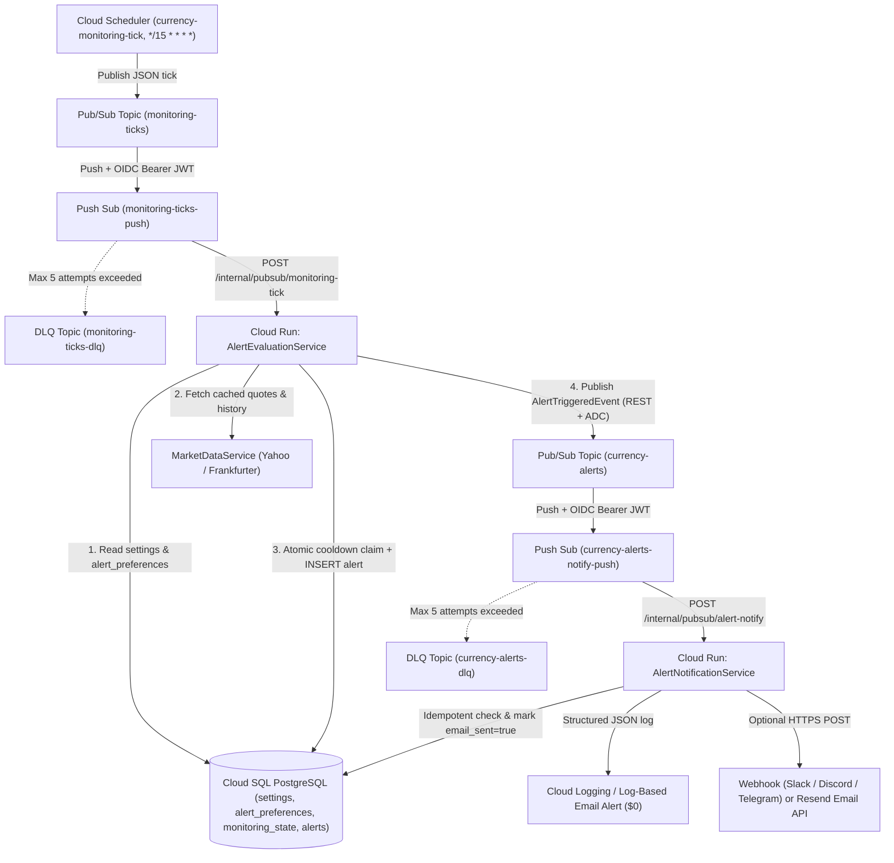
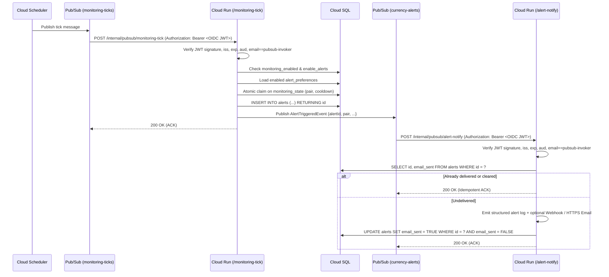

# GCP Pub/Sub Alert Monitoring & Notification Pipeline Plan (Phase 1A + 1B)

**Date:** 2026-11-24  
**Project ID:** `project-3806d7a4-0bd7-416f-8c4`  
**Region:** `us-west1`  
**Cloud Run Service:** `currency-analyzer-java`  
**Base Schema & APIs:** Builds on PR #11 (`com.currencyanalyzer.alerts`) and [V1__baseline_schema.sql](file:///c:/Users/cyche/Documents/ChatGPT/currency-analyzer-java/src/main/resources/db/migration/V1__baseline_schema.sql)  

---

## 1. Goals & Why Phase 1A + 1B Fit Together

On Cloud Run (`--min-instances=0`), in-memory `@Scheduled` timers stop running whenever the container scales to zero, and Coupling outbound notifications (webhooks/email) directly inside a market-check loop means a slow or failing notification endpoint can block or duplicate market evaluations.

Combining **Phase 1A** and **Phase 1B** solves both problems using **100% Always Free tier** GCP primitives:

- **Phase 1A (Scheduled Market Evaluation):** `Cloud Scheduler` publishes a periodic tick to a `monitoring-ticks` Pub/Sub topic. Pub/Sub wakes Cloud Run via an **OIDC-authenticated HTTP Push**, evaluates enabled rules in `alert_preferences` against live/historical rates from [MarketDataService.java](file:///c:/Users/cyche/Documents/ChatGPT/currency-analyzer-java/src/main/java/com/currencyanalyzer/marketdata/MarketDataService.java), enforces per-pair cooldowns in `monitoring_state`, and records triggered alerts in `alerts`.
- **Phase 1B (Decoupled Alert Fan-Out & Delivery):** For each newly inserted row in `alerts`, Cloud Run publishes an `AlertTriggeredEvent` to a second Pub/Sub topic (`currency-alerts`). A separate push subscription (`currency-alerts-notify-push`) delivers the event back to `POST /internal/pubsub/alert-notify` with independent retry backoff, a Dead-Letter Queue (`currency-alerts-dlq`), idempotency tracking (`alerts.email_sent`), structured Cloud Logging (for \$0 native GCP alerts), and optional Webhook / HTTPS Email delivery.

---

## 2. End-to-End Architecture



> [!IMPORTANT]
> Because `currency-analyzer-java` grants `roles/run.invoker` to `allUsers` so browsers can load `/login.html`, Cloud Run IAM alone **cannot** protect `/internal/pubsub/**` from internet callers. Spring Boot **must** cryptographically verify the Google-signed OIDC Bearer JWT on every `/internal/pubsub/**` request and **fail closed (`403 Forbidden`)** whenever OIDC verification settings are blank.

---

## 3. Sequence & Concurrency Guarantees



### Key Safety & Concurrency Invariants
1. **Zero Extra Heavy Dependencies:**
   - **OIDC Verification:** Uses `com.google.auth.oauth2.TokenVerifier` from `google-auth-library-oauth2-http` (already on the classpath via `google-cloud-storage`), avoiding extra OAuth2/JOSE dependencies.
   - **Pub/Sub Publishing:** Uses `GoogleCredentials` (ADC scoped to `https://www.googleapis.com/auth/pubsub`) + Spring `RestClient` against `POST https://pubsub.googleapis.com/v1/projects/{project}/topics/{topic}:publish`, avoiding ~35 MB of transitive gRPC/Netty shaded jars and respecting `HTTPS_PROXY` / `HTTP_PROXY` per [AGENTS.md](file:///c:/Users/cyche/Documents/ChatGPT/currency-analyzer-java/AGENTS.md).
2. **Single Shared Audience Across All Push Subscriptions:**
   - Configure `--push-auth-token-audience="${SERVICE_URL}"` on both `monitoring-ticks-push` and `currency-alerts-notify-push` (and future Phase 2 `gcs-rag-sync`). One env var (`PUBSUB_PUSH_AUDIENCE=${SERVICE_URL}`) secures all `/internal/pubsub/**` endpoints cleanly.
3. **Atomic Duplicate-Tick Suppression (`monitoring_state`):**
   - Pub/Sub guarantees *at-least-once* delivery. To prevent concurrent ticks from inserting duplicate alerts for the same pair within the cooldown window (`app.pubsub.alert-cooldown-seconds`, default `3600`s):
     - Attempt `UPDATE monitoring_state SET last_alert_time = ? WHERE pair = ? AND (last_alert_time IS NULL OR last_alert_time <= ?)`.
     - Only if no row exists for `pair`, `INSERT INTO monitoring_state (pair, last_alert_time) VALUES (?, ?)` catching `DuplicateKeyException` (if a racing thread inserted first, treat as cooldown-active and skip).
4. **At-Least-Once Notification Idempotency (`alerts.email_sent`):**
   - `AlertNotificationService` checks `email_sent` before sending and executes `UPDATE alerts SET email_sent = TRUE WHERE id = ? AND email_sent = FALSE` afterward. Transient downstream HTTP errors throw `502 Bad Gateway` so Pub/Sub retries with exponential backoff (`10s` to `300s`, up to 5 attempts before routing to `currency-alerts-dlq`).

---

## 4. Planned Repository Changes

Branch: `feat/gcp-pubsub-alert-pipeline` (branched from `origin/master` after PR #11 merge).  
No Flyway migration is needed — all columns already exist in [V1__baseline_schema.sql](file:///c:/Users/cyche/Documents/ChatGPT/currency-analyzer-java/src/main/resources/db/migration/V1__baseline_schema.sql).

### 4.1 Configuration & Security
- **[MODIFY] [application.yml](file:///c:/Users/cyche/Documents/ChatGPT/currency-analyzer-java/src/main/resources/application.yml)**
  Add `app.pubsub` and `app.alerts.notifications` properties (fail-closed defaults when unconfigured):
  ```yaml
  app:
    pubsub:
      enabled: ${PUBSUB_ENABLED:false}
      project-id: ${GCP_PROJECT_ID:project-3806d7a4-0bd7-416f-8c4}
      push-audience: ${PUBSUB_PUSH_AUDIENCE:}
      push-service-account: ${PUBSUB_PUSH_SERVICE_ACCOUNT:}
      alerts-topic: ${PUBSUB_ALERTS_TOPIC:}
      alert-cooldown-seconds: ${ALERT_COOLDOWN_SECONDS:3600}
      credentials-path: ${GCP_CREDENTIALS_PATH:}
    alerts:
      webhook-url: ${ALERT_WEBHOOK_URL:}
      resend-api-key: ${RESEND_API_KEY:}
      resend-from-email: ${RESEND_FROM_EMAIL:onboarding@resend.dev}
  ```
- **[NEW] `src/main/java/com/currencyanalyzer/pubsub/PubSubOidcVerifier.java`**
  - Wraps `TokenVerifier` (configured with proxy-aware `HttpTransportFactory` matching [GcsObjectStorageClient.java](file:///c:/Users/cyche/Documents/ChatGPT/currency-analyzer-java/src/main/java/com/currencyanalyzer/storage/GcsObjectStorageClient.java), plus package-private constructor accepting a custom `TokenVerifier` for offline RSA unit/integration tests).
  - Fails closed (`false`) if `enabled` is `false`, `pushAudience` is blank, `pushServiceAccount` is blank, header is missing/non-Bearer, token verification fails, `email_verified != true`, or `email` does not match `pushServiceAccount` (case-insensitive).
- **[NEW] `src/main/java/com/currencyanalyzer/pubsub/PubSubAuthenticationFilter.java`**
  - `OncePerRequestFilter` applied only to `/internal/pubsub/**`; populates a `PreAuthenticatedAuthenticationToken` (`ROLE_PUBSUB_PUSH`) on valid OIDC tokens or writes JSON `403 Forbidden` (`{"success":false,"error":"Forbidden"}`).
- **[MODIFY] [WebSecurityConfig.java](file:///c:/Users/cyche/Documents/ChatGPT/currency-analyzer-java/src/main/java/com/currencyanalyzer/config/WebSecurityConfig.java)**
  - Add an `@Order(1)` `SecurityFilterChain` matching `/internal/pubsub/**` with `SessionCreationPolicy.STATELESS`, CSRF disabled (Bearer JWT auth, no session cookies), `PubSubAuthenticationFilter`, and `.anyRequest().hasAuthority("ROLE_PUBSUB_PUSH")`. Keep existing browser/API filter chain at `@Order(2)`.

### 4.2 Phase 1A — Rule Evaluation & Cooldown Persistence
- **[MODIFY] `src/main/java/com/currencyanalyzer/alerts/AlertMonitoringRepository.java`**
  - Add `claimCooldownWindow(String pair, Instant now, Instant cutoff)` using the atomic `monitoring_state` SQL guard.
  - Add `insertAlert(...)` returning the generated `AlertEntry` (with `id` and `timestamp`).
  - Add `findAlertById(long id)` and `markAlertDelivered(long id)` (`UPDATE alerts SET email_sent = TRUE WHERE id = ? AND email_sent = FALSE`).
- **[NEW] `src/main/java/com/currencyanalyzer/alerts/AlertEvaluationService.java`**
  - Checks `monitoring_enabled` and `enable_alerts`.
  - Evaluates enabled `alert_preferences` across all 3 rule types:
    - `percentage_change` (live 1d change when `period == 1`, or `period`-day historical window + optional directional consistency check)
    - `price_threshold` (`above`, `below`, `outside_range`)
    - `moving_average_crossover` (`golden_cross`, `death_cross`, `both` over `ma_short_period` / `ma_long_period`)
  - Claims `monitoring_state` cooldown, inserts into `alerts`, and invokes `AlertEventPublisher.publish(AlertTriggeredEvent)` for each triggered alert.

### 4.3 Phase 1B — Pub/Sub Event Publisher, Notification Consumer & Test Email
- **[NEW] `src/main/java/com/currencyanalyzer/pubsub/AlertTriggeredEvent.java`**
  - Record serialized as JSON into Pub/Sub `messages[].data` (`alertId`, `pair`, `alertType`, `percentChange`, `oldRate`, `newRate`, `triggerValue`, `thresholdValue`, `timestamp`).
- **[NEW] `src/main/java/com/currencyanalyzer/pubsub/AlertEventPublisher.java` & `GcpPubSubRestAlertEventPublisher.java` & `PubSubConfiguration.java`**
  - Single `@Bean` factory in `PubSubConfiguration` (per `AGENTS.md` `java:S9352` rule): returns `GcpPubSubRestAlertEventPublisher` when `app.pubsub.alerts-topic` is non-blank, otherwise a no-op logger implementation for local dev/tests.
- **[NEW] `src/main/java/com/currencyanalyzer/alerts/AlertNotificationService.java`**
  - Idempotently processes `AlertTriggeredEvent`:
    1. Checks `findAlertById(alertId)` and skips if missing or `emailSent() == true`.
    2. Logs structured event (`CURRENCY_ALERT_TRIGGERED`) for Cloud Logging / Cloud Monitoring native alerts.
    3. Sends optional HTTPS webhook (`ALERT_WEBHOOK_URL`) and/or Resend HTTPS email (`RESEND_API_KEY` + `settings.alert_email`).
    4. Calls `markAlertDelivered(alertId)`.
  - Also exposes `sendTestNotification()` wired to `POST /api/test-email` (admin-only in `AlertMonitoringController`) so the existing **Send Test Email** button in Settings works cleanly instead of returning `404`.
- **[NEW] `src/main/java/com/currencyanalyzer/pubsub/PubSubPushController.java`**
  - `POST /internal/pubsub/monitoring-tick` → triggers `AlertEvaluationService.evaluateTick()`
  - `POST /internal/pubsub/alert-notify` → decodes base64 `message.data` into `AlertTriggeredEvent` and invokes `AlertNotificationService.deliver(...)`
- **[MODIFY] [dashboard.js](file:///c:/Users/cyche/Documents/ChatGPT/currency-analyzer-java/src/main/resources/static/dashboard.js)**
  - Fix `renderAlerts` so negative `percent_change` values format as `-2.15%` rather than `+-2.15%`, and format alert timestamps with explicit `'en-US'` locale per `AGENTS.md`.
- **[MODIFY] [deploy-cloud-run.yml](file:///c:/Users/cyche/Documents/ChatGPT/currency-analyzer-java/.github/workflows/deploy-cloud-run.yml)**
  - Pass `PUBSUB_ENABLED`, `PUBSUB_PUSH_AUDIENCE`, `PUBSUB_PUSH_SERVICE_ACCOUNT`, `PUBSUB_ALERTS_TOPIC`, and optional `ALERT_WEBHOOK_URL` env vars.
- **[NEW] `docs/GCP_PUBSUB_ALERT_PIPELINE_PLAN.md`**
  - Commit this architecture & runbook into `docs/` alongside existing deployment docs.

---

## 5. GCP Provisioning Runbook (Cloud Shell)

> [!TIP]
> Every resource below falls inside GCP's **Always Free** monthly allowance (Cloud Scheduler: 3 free jobs/month; Pub/Sub: 10 GB/month free; Cloud Logging/Monitoring log-based email alerts: free).

```bash
export PROJECT_ID="project-3806d7a4-0bd7-416f-8c4"
export REGION="us-west1"
export SERVICE_NAME="currency-analyzer-java"
export SERVICE_URL=$(gcloud run services describe "$SERVICE_NAME" --region="$REGION" --project="$PROJECT_ID" --format='value(status.url)')
export INVOKER_SA="pubsub-invoker@${PROJECT_ID}.iam.gserviceaccount.com"
export RUNTIME_SA="currency-analyzer-run@${PROJECT_ID}.iam.gserviceaccount.com"
export PROJECT_NUMBER=$(gcloud projects describe "$PROJECT_ID" --format='value(projectNumber)')
export PUBSUB_AGENT="service-${PROJECT_NUMBER}@gcp-sa-pubsub.iam.gserviceaccount.com"

# 1. Enable Pub/Sub and Cloud Scheduler APIs
gcloud services enable pubsub.googleapis.com cloudscheduler.googleapis.com --project="$PROJECT_ID"

# 2. Dedicated OIDC push identity (no IAM roles needed; Spring Boot verifies its signed email + audience)
gcloud iam service-accounts create pubsub-invoker \
  --display-name="Pub/Sub Push OIDC Identity" \
  --project="$PROJECT_ID"

# Allow Pub/Sub service agent to mint OIDC tokens for pubsub-invoker
gcloud iam service-accounts add-iam-policy-binding "$INVOKER_SA" \
  --member="serviceAccount:${PUBSUB_AGENT}" \
  --role="roles/iam.serviceAccountTokenCreator" \
  --project="$PROJECT_ID"

# 3. Create Phase 1A + 1B topics and Dead-Letter topics
for TOPIC in monitoring-ticks monitoring-ticks-dlq currency-alerts currency-alerts-dlq; do
  gcloud pubsub topics create "$TOPIC" --project="$PROJECT_ID"
done

gcloud pubsub subscriptions create monitoring-ticks-dlq-sub --topic=monitoring-ticks-dlq --project="$PROJECT_ID"
gcloud pubsub subscriptions create currency-alerts-dlq-sub --topic=currency-alerts-dlq --project="$PROJECT_ID"

# Grant Cloud Run runtime SA permission to publish triggered alerts to currency-alerts
gcloud pubsub topics add-iam-policy-binding currency-alerts \
  --member="serviceAccount:${RUNTIME_SA}" \
  --role="roles/pubsub.publisher" \
  --project="$PROJECT_ID"

# Grant Pub/Sub agent permission to publish undeliverable messages to both DLQs
for DLQ in monitoring-ticks-dlq currency-alerts-dlq; do
  gcloud pubsub topics add-iam-policy-binding "$DLQ" \
    --member="serviceAccount:${PUBSUB_AGENT}" \
    --role="roles/pubsub.publisher" \
    --project="$PROJECT_ID"
done

# 4. Create Phase 1A Push Subscription (monitoring-ticks -> /internal/pubsub/monitoring-tick)
gcloud pubsub subscriptions create monitoring-ticks-push \
  --topic=monitoring-ticks \
  --push-endpoint="${SERVICE_URL}/internal/pubsub/monitoring-tick" \
  --push-auth-service-account="$INVOKER_SA" \
  --push-auth-token-audience="$SERVICE_URL" \
  --ack-deadline=60 \
  --min-retry-delay=30s \
  --max-retry-delay=600s \
  --dead-letter-topic=monitoring-ticks-dlq \
  --max-delivery-attempts=5 \
  --project="$PROJECT_ID"

# 5. Create Phase 1B Push Subscription (currency-alerts -> /internal/pubsub/alert-notify)
gcloud pubsub subscriptions create currency-alerts-notify-push \
  --topic=currency-alerts \
  --push-endpoint="${SERVICE_URL}/internal/pubsub/alert-notify" \
  --push-auth-service-account="$INVOKER_SA" \
  --push-auth-token-audience="$SERVICE_URL" \
  --ack-deadline=60 \
  --min-retry-delay=10s \
  --max-retry-delay=300s \
  --dead-letter-topic=currency-alerts-dlq \
  --max-delivery-attempts=5 \
  --project="$PROJECT_ID"

for SUB in monitoring-ticks-push currency-alerts-notify-push; do
  gcloud pubsub subscriptions add-iam-policy-binding "$SUB" \
    --member="serviceAccount:${PUBSUB_AGENT}" \
    --role="roles/pubsub.subscriber" \
    --project="$PROJECT_ID"
done

# 6. Create Cloud Scheduler job (every 15 minutes)
gcloud scheduler jobs create pubsub currency-monitoring-tick \
  --location="$REGION" \
  --schedule="*/15 * * * *" \
  --topic=monitoring-ticks \
  --message-body='{"source":"cloud-scheduler","type":"monitoring-tick"}' \
  --project="$PROJECT_ID"
```

### GitHub Actions Variables to Set Before Merging
Under **Settings → Secrets and variables → Actions → Variables**:
- `PUBSUB_ENABLED` = `true`
- `PUBSUB_PUSH_AUDIENCE` = `<exact output of $SERVICE_URL>` (e.g., `https://currency-analyzer-java-g5vm3qll5q-uw.a.run.app`)
- `PUBSUB_ALERTS_TOPIC` = `currency-alerts`
- *(Optional)* `ALERT_WEBHOOK_URL` in **Secrets** if you want Slack/Discord/Telegram push alerts right away.

---

## 6. Verification & Quality Gate Plan

1. **Security & OIDC Integration Tests (`PubSubPushControllerTests`):**
   - Anonymous, session-cookie-only, invalid JWT, wrong `aud`, wrong `email`, and disabled-config requests to `/internal/pubsub/monitoring-tick` and `/internal/pubsub/alert-notify` all return `403 Forbidden`.
   - Valid RSA-signed JWT matching `pushAudience` + `pushServiceAccount` succeeds (`200 OK`).
2. **Rule Engine & Cooldown Tests (`AlertEvaluationServiceTests`):**
   - Skips when `monitoring_enabled=false` or `enable_alerts=false`.
   - Evaluates `percentage_change`, `price_threshold`, and `moving_average_crossover` accurately.
   - Verifies atomic `monitoring_state` cooldown prevents duplicate alerts on repeated ticks within the cooldown window, and publishes `AlertTriggeredEvent` once per triggered alert.
3. **Phase 1B Idempotency & Retry Tests (`AlertNotificationServiceTests`):**
   - First delivery dispatches webhook/log and sets `alerts.email_sent = true`.
   - Duplicate redelivery of the same `alertId` short-circuits cleanly (`200 OK`) without sending a second notification.
   - Upstream webhook `500` surfaces `502 Bad Gateway` so Pub/Sub retries and eventually routes to DLQ.
4. **Full Build & SonarCloud Pre-Flight:**
   - Run `.\mvnw.cmd -o clean verify` on JDK 25 (`0` failures, `0` Mockito warnings, `>= 85%` JaCoCo combined coverage across all new classes).
5. **Live Cloud Run End-to-End Smoke Test (post-deploy):**
   - Click **Start Monitoring** in the dashboard, run `gcloud scheduler jobs run currency-monitoring-tick --location=us-west1`, and verify tick evaluation + alert fan-out in Cloud Run logs and the **Alert History** tab.
