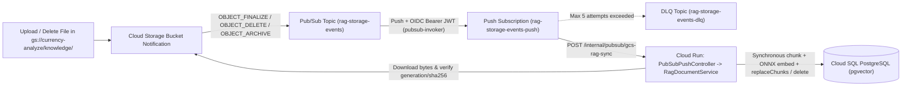

# GCS → Pub/Sub → Cloud Run Automatic RAG Sync Plan

**Date:** 2026-11-24  
**Project ID:** `project-3806d7a4-0bd7-416f-8c4`  
**Region:** `us-west1`  
**Bucket:** `gs://currency-analyze` (prefix: `knowledge/`)  
**Cloud Run Service:** `currency-analyzer-java` (`https://currency-analyzer-java-921112761651.us-west1.run.app`)  

---

## 1. Architecture



### Key Design Properties
- **Zero New GitHub Variables or Secrets:** Reuses the exact same `@Order(1)` fail-closed Google OIDC security chain (`/internal/pubsub/**`), `pubsub-invoker` service account, and `PUBSUB_PUSH_AUDIENCE=https://currency-analyzer-java-921112761651.us-west1.run.app`.
- **Synchronous Ingestion (`ingestNow`):** Completes chunking, ONNX embedding, and PostgreSQL upsert *before* ACKing Pub/Sub so Cloud Run never throttles an unfinished background thread, and transient failures trigger Pub/Sub exponential backoff + DLQ.
- **Overwrite & Race Safety:**
  - `OBJECT_ARCHIVE` / `OBJECT_DELETE` carrying `overwrittenByGeneration` or a generation older than `rag_documents.storage_generation` are skipped so overwriting a file never deletes the newer generation.
  - Duplicate `OBJECT_FINALIZE` events (e.g., after a Dashboard UI upload or Pub/Sub redelivery) with the same generation or unchanged `sha256` are skipped idempotently.
  - Strict prefix scoping rejects `..` segments, directory markers (`/`), sibling prefixes (`knowledge-other/...`), and unsupported file types.

---

## 2. One-Time GCP Provisioning Runbook (Cloud Shell)

Run these commands once after merging the PR:

```bash
export PROJECT_ID="project-3806d7a4-0bd7-416f-8c4"
export BUCKET="currency-analyze"
export AUDIENCE="https://currency-analyzer-java-921112761651.us-west1.run.app"
export INVOKER_SA="pubsub-invoker@${PROJECT_ID}.iam.gserviceaccount.com"
export PROJECT_NUMBER=$(gcloud projects describe "$PROJECT_ID" --format='value(projectNumber)')
export PUBSUB_AGENT="service-${PROJECT_NUMBER}@gcp-sa-pubsub.iam.gserviceaccount.com"
export GCS_AGENT=$(gcloud storage service-agent --project="$PROJECT_ID")

# 1. Create RAG storage event topic and Dead-Letter Queue
gcloud pubsub topics create rag-storage-events --project="$PROJECT_ID"
gcloud pubsub topics create rag-storage-events-dlq --project="$PROJECT_ID"
gcloud pubsub subscriptions create rag-storage-events-dlq-sub \
  --topic=rag-storage-events-dlq --project="$PROJECT_ID"

# 2. Allow GCS service agent to publish notifications to rag-storage-events
gcloud pubsub topics add-iam-policy-binding rag-storage-events \
  --member="serviceAccount:${GCS_AGENT}" \
  --role="roles/pubsub.publisher" \
  --project="$PROJECT_ID"

# 3. Allow Pub/Sub service agent to forward poison messages to the DLQ
gcloud pubsub topics add-iam-policy-binding rag-storage-events-dlq \
  --member="serviceAccount:${PUBSUB_AGENT}" \
  --role="roles/pubsub.publisher" \
  --project="$PROJECT_ID"

# 4. Create OIDC-authenticated Push Subscription to Cloud Run (180s ack deadline for larger docs)
gcloud pubsub subscriptions create rag-storage-events-push \
  --topic=rag-storage-events \
  --push-endpoint="${AUDIENCE}/internal/pubsub/gcs-rag-sync" \
  --push-auth-service-account="$INVOKER_SA" \
  --push-auth-token-audience="$AUDIENCE" \
  --ack-deadline=180 \
  --min-retry-delay=30s \
  --max-retry-delay=600s \
  --dead-letter-topic=rag-storage-events-dlq \
  --max-delivery-attempts=5 \
  --project="$PROJECT_ID"

gcloud pubsub subscriptions add-iam-policy-binding rag-storage-events-push \
  --member="serviceAccount:${PUBSUB_AGENT}" \
  --role="roles/pubsub.subscriber" \
  --project="$PROJECT_ID"

# 5. Attach bucket notification scoped strictly to knowledge/
gcloud storage buckets notifications create "gs://${BUCKET}" \
  --topic=rag-storage-events \
  --payload-format=json \
  --object-prefix=knowledge/ \
  --event-types=OBJECT_FINALIZE,OBJECT_DELETE,OBJECT_ARCHIVE \
  --project="$PROJECT_ID"
```

---

## 3. Live Smoke Test (Cloud Shell)

```bash
# 1. Upload a test markdown note directly into GCS
printf '# Pub/Sub RAG Smoke Test\n\nFederal Reserve policy notes auto-indexed via GCS notifications.\n' > /tmp/pubsub-rag-test.md
gcloud storage cp /tmp/pubsub-rag-test.md gs://currency-analyze/knowledge/pubsub-rag-test.md

# 2. Wait ~5 seconds and verify Cloud Run indexed it automatically
sleep 5
gcloud run services logs read currency-analyzer-java \
  --region=us-west1 \
  --project=project-3806d7a4-0bd7-416f-8c4 \
  --limit=25

# 3. Delete the test note and verify Cloud Run pruned it automatically
gcloud storage rm gs://currency-analyze/knowledge/pubsub-rag-test.md
```
