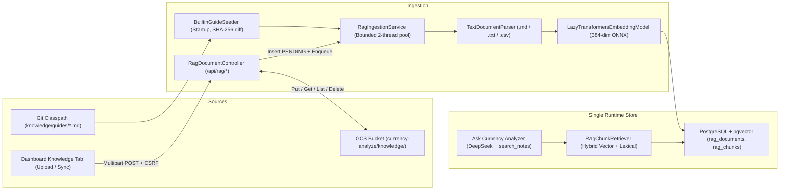

# GCS Knowledge Storage & Unified PostgreSQL (`pgvector`) RAG Pipeline — Design & Implementation Plan

**Status:** Implemented

**Created:** 2026-11-22

**Target application:** Currency Analyzer Java (Java 25, Spring Boot 4.1.2, Spring AI 2.0.2)

---

## 1. Goal & Architecture

Upgrade Currency Analyzer Java from a static, in-memory `SimpleVectorStore` prototype to a **single, persistent PostgreSQL (`pgvector`) RAG pipeline** backed by **Google Cloud Storage** (`currency-analyze`):

1. **Single runtime retrieval store:** The AI assistant (**Ask Currency Analyzer** & `search_notes`) queries PostgreSQL (`rag_documents` + `rag_chunks` with `pgvector` cosine search + lexical/hybrid fusion) for all knowledge.
2. **Clean separation of code vs. knowledge content:**
   - **Built-in application guides** (`src/main/resources/knowledge/guides/*.md`) stay versioned in Git and are automatically seeded into PostgreSQL on startup (`source = 'builtin'`, read-only in UI, skipped when `sha256` is unchanged).
   - **Dynamic knowledge documents** (`.md`, `.txt`, `.csv` — including investment concepts and entity notes) live in **GCS** (`source = 'upload'`), managed through the **Knowledge** dashboard tab (upload, download, re-index, delete) and bulk-imported via **Sync from GCS** (`POST /api/rag/sync`).
   - Personal `journal/` notes are excluded from the code repository.



---

## 2. Key Design Decisions

- **Access model:** Shared workspace (all authenticated users can view and query indexed documents; `uploaded_by` is recorded on every document for auditability).
- **Supported formats (Phase 1):** `.md`, `.markdown`, `.txt`, `.csv` behind an extensible `DocumentParser` interface (PDF/OCR parsers can be added later without changing storage, schema, or retrieval).
- **File size limit:** Default **5 MB** (`RAG_MAX_FILE_SIZE` / `RAG_MAX_FILE_SIZE_BYTES`), environment-overridable when larger PDFs are added later.
- **Database persistence & test compatibility:**
  - `src/main/resources/db/migration/V5__rag_documents_schema.sql`: H2 + PostgreSQL compatible metadata (`rag_documents`) and chunk (`rag_chunks`) tables.
  - `src/main/resources/db/postgresql-migration/V6__rag_pgvector.sql`: PostgreSQL-only sibling migration (skipped by H2 tests) conditionally enabling `CREATE EXTENSION IF NOT EXISTS vector`, `embedding vector(384)`, and an HNSW `vector_cosine_ops` index.
- **Embeddings:** Reuses the local multilingual ONNX model (`paraphrase-multilingual-MiniLM-L12-v2`, 384 dimensions, 256-token max window) via a standalone `EmbeddingModel` bean (`RagEmbeddingConfiguration`) so indexing works independently of `app.ai.enabled`.
- **GCP authentication:** Supports `GOOGLE_APPLICATION_CREDENTIALS` service-account JSON, explicit `app.storage.gcs.credentials-path`, or keyless Application Default Credentials (`gcloud auth application-default login` / GCP Workload Identity). Automatically honors `HTTPS_PROXY` / `HTTP_PROXY` environment variables.

---

## 3. Data Model

### `rag_documents` (`V5__rag_documents_schema.sql`)
- `id UUID PRIMARY KEY`
- `source VARCHAR(16)` — `'builtin'` or `'upload'`
- `filename`, `title`, `content_type`, `size_bytes`, `sha256`
- `storage_provider`, `storage_bucket`, `storage_key`, `storage_generation` (`UNIQUE (storage_provider, storage_key)`)
- `status VARCHAR(24)` — `'PENDING'`, `'INDEXING'`, `'READY'`, `'FAILED'`
- `chunk_count`, `error_message`, `uploaded_by`, `created_at`, `updated_at`

### `rag_chunks` (`V5` + `V6__rag_pgvector.sql`)
- `id UUID PRIMARY KEY`
- `document_id UUID REFERENCES rag_documents(id) ON DELETE CASCADE`
- `chunk_index`, `heading`, `content`, `char_count`, `created_at`
- `embedding vector(384)` + HNSW cosine index (PostgreSQL with `pgvector`)

---

## 4. API Surface (`/api/rag`)

All endpoints require authentication (existing Spring Security session auth + CSRF on mutating requests):

| Method & Path | Purpose | Status |
|---|---|---|
| `GET /api/rag/info` | Active storage provider, bucket, default prefix, max file size, `pgvector` status | `200 OK` |
| `GET /api/rag/documents` | List all built-in guides and uploaded documents | `200 OK` |
| `GET /api/rag/documents/{id}` | Fetch single document metadata & ingestion status | `200` / `404` |
| `POST /api/rag/documents` | Multipart upload (`file`, optional `title`) → GCS put → async index | `202 Accepted` |
| `POST /api/rag/sync?prefix=...` | Incremental scan of GCS bucket prefix; queues new/changed files | `202 Accepted` |
| `POST /api/rag/documents/{id}/reindex` | Re-parse and re-embed document from source storage | `202` / `404` |
| `GET /api/rag/documents/{id}/download` | Download raw file (`Content-Disposition: attachment`, `X-Content-Type-Options: nosniff`) | `200` / `404` |
| `DELETE /api/rag/documents/{id}` | Delete from GCS and cascade-delete DB chunks (blocks `builtin` guides) | `204` / `400` / `404` |
| `GET /api/rag/search?q=...&limit=4` | Hybrid retrieval preview returning matched chunks and scores | `200 OK` |

---

## 5. Configuration Reference

Key environment variables (defined in `src/main/resources/application.yml` and `compose.yaml`):

```text
POSTGRES_PORT=5434
DATABASE_URL=jdbc:postgresql://localhost:5434/currency_analyzer
STORAGE_PROVIDER=gcs                  # or 'local' for offline dev/tests
GCP_PROJECT_ID=project-3806d7a4-0bd7-416f-8c4
GCP_STORAGE_BUCKET=currency-analyze
GCP_STORAGE_PREFIX=knowledge
GOOGLE_APPLICATION_CREDENTIALS=       # path to service-account or ADC JSON outside repo
RAG_ENABLED=true
RAG_SEED_BUILTIN_GUIDES=true
RAG_MAX_FILE_SIZE=5MB
RAG_MAX_FILE_SIZE_BYTES=5242880
RAG_CHUNK_MAX_CHARS=600
RAG_CHUNK_OVERLAP_CHARS=100
RAG_SIMILARITY_THRESHOLD=0.45
```

---

## 6. Verification Plan

- **Automated tests (`.\mvnw.cmd -o clean test` with Java 25):**
  - `TextDocumentParserTests`: Markdown front matter & heading chunking, metadata stub merging, tag footer filtering, CSV header repetition, TXT overlap, binary/extension validation.
  - `RagPipelineIntegrationTests`: Upload → async indexing → retrieval → delete cascade, incremental `syncFromStorage`, idempotent `BuiltinGuideSeeder`, bilingual entity expansion & noise filtering.
  - `RagDocumentControllerTests`: Auth (`401`), CSRF (`403` / `202`), multipart upload, `/api/rag/sync`, invalid file rejection (`400`), safe download headers, `/api/rag/search`, delete (`204` / `404`).
  - Existing AI assistant & retrieval suites (`KnowledgeRetrieverTests`, `AssistantSpringAiConfigurationTests`, `AiConversationControllerTests`).
- **Live verification:**
  - Start `pgvector/pgvector:pg16` (`docker compose up -d postgres`).
  - Run `.\mvnw.cmd spring-boot:run` with `GOOGLE_APPLICATION_CREDENTIALS` configured.
  - Open `http://localhost:5000/dashboard.html` → **Knowledge** tab → verify `pgvector (384-dim cosine)`, sync `knowledge/` from GCS, test upload/download/delete, and validate retrieval quality in **Test RAG Retrieval** and **Ask Currency Analyzer**.
