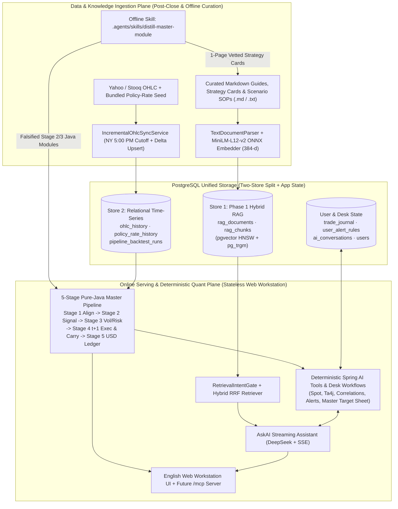

# Currency Analyzer Java — System Architecture Summary & Decision Log (ADR)

**Last Updated:** 2026-11-27  
**Current Baseline:** Milestone 1 Complete ([PR #23](https://github.com/cychengming/currency-analyzer-java/pull/23))  
**Stack:** Java 25 · Spring Boot 4.1.2 · Spring AI 2.0.2 · `ta4j-core` 0.29.0 · `hipparchus-stat` 4.0.3 · PostgreSQL (`pgvector` + `pg_trgm`) · Cloud Run · GCS

---

## 1. High-Level Architecture Summary

`currency-analyzer-java` is designed as a **quant-assisted discretionary FX & Metals trading workstation**. Rather than asking an LLM to improvise trading signals from contradictory books or raw CSV files, the architecture separates **deterministic quantitative computation**, **relational market history**, **curated procedural RAG**, and **interactive AI assistance** into explicit layers:

### Core Architectural Pillars
1. **Deterministic Code Owns Numbers; LLM Owns Explanation & Workflow Synthesis:** All signals, volatility targets, `t+1` fills, Wednesday `3x` swap rollovers, and Spot-vs-Carry P&L attribution run in pure Java (`com.currencyanalyzer.quant.pipeline`). AskAI invokes typed tools and reads structured outputs—never guessing prices or sizing math.
2. **Two-Store Knowledge & Data Split:**
   - **Store 1 (`rag_documents` / `rag_chunks`):** `.md` and `.txt` prose only—system guides, 1-page Vetted Strategy Cards, and customer-support-style Desk Scenario SOPs (`Trigger -> Tools -> Protocol -> Red Lines`).
   - **Store 2 (`ohlc_history` / `policy_rate_history`):** Relational SQL tables for daily G10 FX + `GOLD/USD` / `SILVER/USD` OHLC bars and central-bank policy rates, updated incrementally after the 5:00 PM NY close.
3. **One Canonical Benchmark Spine + Pluggable Master Arena:** Production target sheets rely on a single conflict-free **Carver / AQR Trend + Carry + Volatility Targeting** spine (`CarverAqrSignalEngine` + `VolatilityTargetRiskSizer`). Other masters (Dennis/Parker Donchian, Druckenmiller Rate-Impulse, PTJ/Thorp/Marks Drawdown & Vol Throttle) compete in the **Master Arena** as pluggable Stage 2/3 modules.

---

## 2. Storage Ownership Matrix

| Store / Domain | PostgreSQL Tables & Resources | Data Format | Write Path | Read / Query Path |
|---|---|---|---|---|
| **Store 1: Procedural & Strategy RAG** | `rag_documents`, `rag_chunks`, `classpath:knowledge/{guides,strategies,scenarios}/`, `gs://currency-analyze/knowledge/` | `.md`, `.txt` only (`.csv` banned) | Built-in seeder, admin GCS sync / upload (`RagDocumentService` -> `RagIngestionService`) | `RetrievalIntentGate` -> `RagChunkRetriever` (`pgvector` + `pg_trgm` RRF) + `KnowledgeLibrary` fallback |
| **Store 2: Market & Macro Time-Series** | `ohlc_history`, `policy_rate_history`, `classpath:marketdata/seed/policy-rates.csv` | Structured SQL rows (`LocalDate`, `DOUBLE PRECISION`) | `IncrementalOhlcSyncService` (`0 15 17 * * MON-FRI` NY cron + lazy read-through) & `seedClasspathPolicyRatesIfEmpty` | `AlignedMarketDataRepository` + `PolicyRateResolver` -> `FxDailyBar` stream |
| **Quant Simulation Audit** | `pipeline_backtest_runs` | JSON config & summary metadata | `AlignedMarketDataRepository.saveBacktestRun` | Strategy Lab & Master Arena comparison APIs |
| **Desk Operations & Auth** | `users`, `user_invites`, `trade_journal`, `user_alert_rules`, `ai_conversations`, `ai_messages` | Relational transactional state | Authenticated REST controllers & confirmed tools (RBAC: `ADMIN`, `MEMBER`, `VIEWER`) | Owner-scoped queries (`username` bound server-side via security context) |

---

## 3. Architecture Decision Log (Decisions Made Along the Way)

### ADR-001: Quant-Assisted Discretionary Workstation (No Live Broker Execution)
- **Context:** Needed to define whether the platform is an autonomous trading bot or a decision-support workstation.
- **Decision:** Build a **quant-assisted discretionary workstation** with paper trading, daily risk-budget enforcement, pre-trade gatekeeping, and behavioral alpha auditing against a systematic benchmark—**no** live broker order routing.
- **Consequence:** Eliminates exchange/broker execution liability and API key custody risk while giving discretionary decisions an objective, friction-adjusted quantitative anchor.

### ADR-002: Pivot from Opinionated "Book-RAG" to "Master-as-Code" & Freeze RAG at Phase 1
- **Context:** Feeding multiple trading masters' books into RAG produces eloquent but contradictory advice (e.g., Carver trend-following vs. Druckenmiller macro rate turns vs. Marks contrarian extremes) with survivorship bias and heavy chunk-maintenance overhead.
- **Decision:**
  1. **Freeze RAG at Phase 1** (defer cross-encoder rerankers, parent-child chunking, and embedding model migrations in [AI_RAG_ARCHITECTURE_REVIEW.md](AI_RAG_ARCHITECTURE_REVIEW.md)).
  2. **Compile Masters into Java Code:** Express master hypotheses as falsifiable Stage 2 (`SignalEngine`) or Stage 3 (`RegimeRiskOverlay`) implementations with `<= 3` parameters, tested across historical crisis regimes before graduating a 1-page Strategy Card into RAG.
  3. **External Marketplace Skills:** Do not inject raw external persona prompts directly into AskAI; treat external investment-master skills strictly as upstream inspiration to be falsified through `.agents/skills/distill-master-module/SKILL.md`.

### ADR-003: Two-Store Split & Removal of `.csv` from Vector RAG
- **Context:** Vector databases (`pgvector`) fragment CSV rows across token windows, corrupt numeric aggregates/lookbacks, and waste embedding compute, whereas operational troubleshooting and crisis playbooks work well in hybrid semantic + lexical search.
- **Decision:**
  - Remove `.csv` parsing and upload support from `TextDocumentParser`, `RagDocumentService`, and frontend upload controls.
  - Restrict Store 1 RAG to curated `.md`/`.txt` documents across three folders: `knowledge/guides/` (system docs), `knowledge/strategies/` (1-page Vetted Strategy Cards), and `knowledge/scenarios/` (customer-support-style Desk Scenario Runbook SOPs).
  - Store all OHLC and central-bank policy-rate series in Store 2 relational PostgreSQL tables (`V10__ohlc_and_policy_rate_store.sql`) with zero manual CSV upload UI.

### ADR-004: Post-NY-Close Incremental Delta Loading + Lazy Read-Through Fallback
- **Context:** Modeled on a proven post-market-close SQLite A-share incremental loader: daily bars should only be persisted after the session closes, fetching only missing delta days rather than re-downloading full histories.
- **Decision:**
  - Anchor daily FX/Metals bars to the **5:00 PM `America/New_York` close** (`IncrementalOhlcSyncService.lastCompletedNyTradingDate`), rolling weekend dates back to Friday so partial intraday candles never pollute closed history.
  - Perform a one-time backfill (`3650` days) when a pair is empty, then fetch and idempotently upsert only `bar_date > MAX(bar_date)` (`0 15 17 * * MON-FRI` NY schedule) with a 5-minute empty-result cooldown.
  - Pair scheduled sync with `ensureSyncedAndEmitAlignedBars(...)` read-through sync and a bundled `policy-rates.csv` seed (`2007–2026` G10 + `XAU`/`XAG`, `0%` base rate for metals) so cold starts and CI tests work deterministically offline.

### ADR-005: 5-Stage Pure-Java Pipeline & Strict Anti-Leakage Mechanics
- **Context:** Naive backtests overstate Sharpe ratios by filling at same-bar Close, ignoring Wednesday `3x` FX tom-next rollovers, churning on tiny daily volatility changes, or confusing interest-rate carry windfalls with directional trend skill.
- **Decision:** Enforce five non-negotiable stage invariants in `com.currencyanalyzer.quant.pipeline`:
  1. **Stage 1 (`AlignedMarketDataRepository`):** Point-in-time `FxDailyBar` alignment with step-function central-bank rates (`PolicyRateResolver`).
  2. **Stage 2 (`SignalEngine`):** Stateless `[-1.0, +1.0]` forecast with mandatory `252`-bar warm-up (`CarverAqrSignalEngine`, `DonchianBreakoutSignalEngine`, `DruckenmillerRateImpulseSignalEngine`).
  3. **Stage 3 (`VolatilityTargetRiskSizer` + `RegimeRiskOverlay`):** Volatility-targeted notional sizing, `10%` rebalance inertia buffer, net-USD cluster exposure caps, and drawdown/vol-spike throttling (`DrawdownAndVolSpikeOverlay`).
  4. **Stage 4 (`ExecutionAndCarrySimulator`):** Delta orders execute strictly at Day `t+1` Open plus pair spread/slippage; daily carry accrues `(r_base - r_quote) - brokerMarkup` with `3x` Wednesday rollover (`0x` Sat/Sun).
  5. **Stage 5 (`PortfolioLedger`):** Converts quote-currency P&L into `USD` equity and explicitly decomposes **Spot P&L**, **Carry P&L**, and **Friction Cost**.

### ADR-006: Two-Tier Skill & Tool Boundary (Dev-Time Distillation vs. Runtime AskAI)
- **Context:** Clarified when `.agents/skills/distill-master-module` runs versus what runs inside the live user-facing AskAI assistant.
- **Decision:**
  - **Offline Dev/Research Time:** Coding agents use `distill-master-module` (and later Milestone 4 `/mcp`) to code, backtest, and falsify new Java modules and commit 1-page Strategy Cards.
  - **Online User Chat Time:** AskAI never compiles or invents strategies on the fly; it uses `RetrievalIntentGate` (skipping RAG on pure price/alert checks for ~20–40% token savings), retrieves matching Scenario SOPs / Strategy Cards when needed, and calls deterministic Java tools & Milestone 3 workflows (`/pre-trade-check`, `/morning-brief`, `/journal-review`).

### ADR-007: Separating Online Serving from the Data & RAG Cleaning Pipeline *(Open Evolution)*
- **Context:** Post-Milestone-1 architectural review highlighted two operational friction points in keeping ETL inside the web container:
  1. **Cloud Run Scale-to-Zero (`min-instances=0`):** In-process `@Scheduled` jobs inside the web container do not fire reliably at 5:15 PM NY if Cloud Run has scaled instances down to zero.
  2. **Service Responsibility & RAG Cleaning:** Mixing user-facing HTTP/SSE serving with cold-start GCS scanning (`RagStartupSyncRunner`), background ONNX chunk embedding (`RagIngestionService`), market-data ETL, and future **raw RAG document cleaning/organization** adds complexity and CPU contention to the web server.
- **Recorded Candidate Architectures (To Finalize Before Scaling Ingestion):**

| Option | Shape | Pros | Cons / Guardrails |
|---|---|---|---|
| **Option A (Recommended Default): Same Repo, Dual Runtime Mode (`Web Service` + `Cloud Run Job`)** | Keep one Java repo & Flyway schema, but run the web container purely for serving (`incremental-sync-enabled=false`, `sync-on-startup=false`) and run batch OHLC sync + RAG indexing via `--spring.main.web-application-type=none` (same pattern as legacy SQLite import in `README.md`), triggered by Cloud Scheduler. | Zero schema drift; guaranteed identical `MiniLM-L12-v2` 384-d embeddings & CJK chunking; reliable scheduled execution even when web `min-instances=0`. | Raw messy external research still needs an offline Markdown prep script/skill before landing in `gs://currency-analyze/knowledge/`. |
| **Option B: Dedicated External Data & RAG Cleaning App** | Standalone pipeline app (e.g., Python ETL + LLM Markdown cleaner/organizer) cleans raw articles/notes into structured `.md` files and loads daily market data; `currency-analyzer-java` becomes a pure read/compute workstation. | Best ecosystem for scraping, PDF/HTML cleaning, and LLM document organization; web app stays ultra-lean. | **Critical Guardrail:** Avoid having two repos run Flyway or compute vectors independently. Either have the external app output clean `.md` to GCS + upsert `ohlc_history` while one owner manages Flyway & `MiniLM-L12-v2` vectors, or share an explicit embedding API contract. |
| **Option C: Keep Single In-Process App + External HTTP Cron Trigger** | Keep current single deployment for now (~10 FX pairs, <30 curated `.md` SOPs) and optionally wake the sync endpoint via Cloud Scheduler at 5:15 PM NY. | Zero new deployment artifacts while corpus is small. | Retains ingestion/upload state machines inside the web process. |

---

## 4. Sequenced Milestone Status

| Milestone | Scope | Status |
|---|---|---|
| **Milestone 1** | Store 2 (`V10` OHLC & Policy-Rate SQL + Post-Close `IncrementalOhlcSyncService`), 5-Stage Pure-Java Master Pipeline (`CarverAqrSignalEngine` + Master Arena modules), Two-Store RAG Split (`.csv` removed, Strategy Card + 4 Scenario SOPs), `distill-master-module` skill | **Completed** ([PR #23](https://github.com/cychengming/currency-analyzer-java/pull/23)) |
| **Milestone 2** | Strategy Lab 5-Stage Trace & Attribution APIs/UI, Paper Trade (`trade_journal`) & Daily Risk Engine, Live Master Target Sheet | **Completed** |
| **Milestone 3** | Deterministic Discretionary-vs-Master Skills (`/pre-trade-check`, `/morning-brief`, `/journal-review`), Behavioral Alpha Audit, Human-in-the-Loop Tool Confirmation | **Next** |
| **Milestone 4** | Authenticated Spring AI `/mcp` Server (`user_api_tokens` Bearer chain) for Automated Master Arena Research | Planned |

Related Detailed Specs:
- [5-Stage Trading Workstation Roadmap](TRADING_WORKSTATION_ROADMAP.md)
- [AI Chat & RAG Architecture Audit](AI_RAG_ARCHITECTURE_REVIEW.md)
- [Cloud Run Deployment Plan](GCP_CLOUD_RUN_DEPLOYMENT_PLAN.md)
