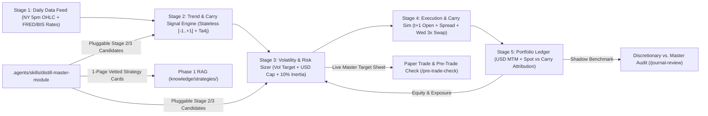

# Currency Analyzer Java — "Master-as-Code" 5-Stage Trading Workstation Roadmap

**Date:** 2026-11-26 (Updated 2026-11-27)  
**Status:** Milestones 1 & 2 Implemented; Milestone 3 Next — see [SYSTEM_ARCHITECTURE_AND_DECISIONS.md](SYSTEM_ARCHITECTURE_AND_DECISIONS.md) for the consolidated Architecture Summary & ADR Log  
**Target Stack:** Java 25, Spring Boot 4.1.2, Spring AI 2.0.2, `ta4j-core` 0.29.0, `hipparchus-stat` 4.0.3, PostgreSQL + `pgvector` / `pg_trgm`, Cloud Run + GCS + Pub/Sub

---

## 1. Strategic Pivot: Why "Master-as-Code" Replaces Opinionated Book-RAG

Raw RAG over trading books and commentary does **not** build an efficient trading system:

1. **Irreconcilable Opinions:** Trend followers (Carver, Parker, Seykota), discretionary macro traders (Druckenmiller, Soros), value contrarians (Marks), and mean-reversion quants contradict one another on entries, sizing, and holding periods. Retrieving chunks from all of them produces eloquent, contradictory rationalizations.
2. **Survivorship & Narrative Bias:** Books recount memorable trades without full friction, swap/carry attribution, or out-of-sample false-positive counts.
3. **High Curation Toil:** Cleaning, chunking, reranking, and maintaining prose notes costs ongoing effort without proving positive expectancy.

**Architectural Resolution (Two-Store Split):**
- **Store 1 — Phase 1 Hybrid RAG (`pgvector` + `pg_trgm`, `.md`/`.txt` only):** Strictly stores **system guides** (`knowledge/guides/`), **1-page Vetted Strategy Cards** (`knowledge/strategies/`), and **Desk Scenario Runbook SOPs** (`knowledge/scenarios/` — customer-support-style `Trigger -> Tools -> Protocol -> Red Lines` procedures for macro shocks, risk emergencies, and Master Spine conflicts). `.csv` uploads are intentionally excluded from `pgvector`. Defer RAG Phase 2.
- **Store 2 — Relational PostgreSQL Time-Series (`ohlc_history` & `policy_rate_history`):** Stores all tabular market prices and central-bank policy rates via a bundled CSV seed + automatic **post-NY-5pm incremental delta sync** (`IncrementalOhlcSyncService` loading `bar_date > MAX(bar_date)` after 17:00 NY, with zero manual CSV upload UI).
- **Compile Masters into Falsifiable Code:** Translate master principles beyond books—via academic replication papers and historical crisis autopsies—into pluggable Stage 2 (`SignalEngine`) and Stage 3 (`PortfolioRiskSizer` / `RegimeRiskOverlay`) Java interfaces, benchmarked against one canonical **Carver / AQR FX Trend + Carry + Volatility Targeting** spine.

---

## 2. The 5-Stage Pure-Java Master Pipeline

### Stage-by-Stage Contracts & Invariants

| Stage | Module / Role | Java Interface Contract | Governing Formula & Rules | Primary Safeguard |
|---|---|---|---|---|
| **Stage 1: `DATA_STORE`** | Daily Data Feed (`SQL / CSV Seed`) | `BarStream<FxDailyBar> emitAligned(LocalDate nyClose5pm)` | Emits 5:00 PM NY-aligned daily OHLC bars for **G10 FX + `GOLD/USD` & `SILVER/USD`** paired with daily base/quote policy rates (`r_base = 0%` for `XAU`/`XAG` vs `USD`). | Strict timestamp alignment eliminates look-ahead leakage across asynchronous Tokyo/London/NY sessions. |
| **Stage 2: `SIGNAL_ENGINE`** | Trend & Carry Signal (`Stateless + Ta4j`) | `double computeSignal(BarSeries series, PolicyRatePair rates, int index)` | Canonical Spine = **Carver / AQR Trend + Carry**: multi-horizon TSMOM / EWMAC (`60/120/252`d) + vol-normalized Carry forecast scaled by Forecast Diversification Multiplier, clamped to `[-1.0, +1.0]`. | Mandatory `252`-bar warm-up period before emitting non-zero signals to prevent unstable early trades. |
| **Stage 3: `RISK_SIZER`** | Volatility & Risk Sizer (`Portfolio Risk Layer`) | `TargetPosition sizeOrder(double signal, PortfolioState state, double pairVol)` | `TargetNotional = signal * (Equity * TargetVolPct) / AnnualizedPairVol`, subject to per-currency & net-USD cluster caps, optional `RegimeRiskOverlay` throttling, and a **10% rebalance inertia buffer**. | Prevents volatile pairs (`GBP/JPY`, `GOLD/USD`) or correlated USD bets from dominating portfolio drawdown, and stops spread churn on tiny daily signal wiggles. |
| **Stage 4: `EXEC_CARRY`** | Execution & Carry Sim (`Broker Friction Layer`) | `FillReport simulateFillAndRollover(Order delta, FxDailyBar nextBar)` | Fills delta orders strictly at Day `t+1` Open with configurable pair spread/slippage (e.g., `2` pips on G10 majors). `DailyCarry = Notional * (r_base - r_quote - brokerMarkup) / 365` (`3x` rollover on Wednesdays). | Eliminates mid-price illusion and accounts for multi-month financing & rollover friction. |
| **Stage 5: `PORTFOLIO_LEDGER`** | Portfolio Ledger (`Attribution & Metrics`) | `LedgerSnapshot markToMarket(FillReport fill, FxDailyBar closeBar, UsdRates fxToUsd)` | Marks open positions to market, converts quote-currency PnL (e.g., `JPY`, `CHF`, `CAD`) into `USD` base equity, and computes Sharpe, Sortino, Max Drawdown, rolling VaR, and turnover. Feeds `Equity & Exposure` back into Stage 3. | Separates **Spot PnL**, **Carry PnL**, and **Friction Drag** so trend edge is never confused with an interest-rate carry windfall. |

### Reference Trace (USD/JPY Example)
- **Stage 1:** `USD/JPY` Close = `152.40`, 20-day ATR = `1.35`, US policy rate = `4.75%`, JP policy rate = `0.25%`.
- **Stage 2:** `60d (+3.2%)`, `120d (+5.8%)`, `252d (+9.1%)` trend + positive carry -> normalized signal = `+1.0` (Long).
- **Stage 3:** On `USD 100,000` equity, `10%` target portfolio vol, and `11.5%` pair vol -> `~USD 86,950` target notional (capped if aggregate net USD exposure exceeds limit, or held unchanged if `|delta| < 10%` inertia threshold).
- **Stage 4:** Delta fills at Day `t+1` Open minus spread/slippage (e.g., `USD 11.40`); open notional accrues `+(4.75% - 0.25% - 1.00%) / 365 = +USD 8.34/day` (`3x` on Wednesday).
- **Stage 5:** `Spot PnL (+USD 412.00) + Carry PnL (+USD 8.34) - Slippage (USD 11.40) = Net Daily PnL (+USD 408.94)`, converted from `JPY` to `USD` base equity.

---

## 3. Learning From Masters Beyond Books: The "Master Arena" & 4-Step Falsification

Instead of storing conflicting prose from 10 masters, **one conflict-free Benchmark Spine** owns production sizing while every other master's mechanism competes inside the **Master Arena** as a pluggable Stage 2 or Stage 3 candidate:

| Master / School | Empirical Anchor Beyond Book | Pipeline Slot | Falsifiable Hypothesis Tested Against Carver/AQR Spine |
|---|---|---|---|
| **Rob Carver / AQR** *(Baseline Spine)* | Moskowitz-Ooi-Pedersen (2012) TSMOM; Koijen et al. (2018) Carry; *Systematic Trading* | Stage 2 + Stage 3 | Continuous multi-speed trend + vol-scaled carry + `10%` inertia delivers durable risk-adjusted returns across regimes. |
| **Richard Dennis / Jerry Parker (Turtles)** | Classic 20/55-day Donchian breakout + ATR unit sizing | Stage 2 Candidate | Does discrete channel breakout + ATR trailing stop outperform continuous EWMAC/TSMOM net of G10 spreads? |
| **Stan Druckenmiller** | Macro liquidity & central-bank rate-impulse shocks | Stage 2 Candidate | Does adding a `90`-day policy-rate differential impulse (`Δ(r_base - r_quote)`) improve crisis turning points without overfitting? |
| **Paul Tudor Jones / Ed Thorp** | Drawdown-heat throttling & fractional-Kelly scaling | Stage 3 Overlay | Does cutting `TargetVolPct` linearly when portfolio equity falls below its 60-day high or trailing Sharpe drops cut tail drawdown faster than it hurts recovery? |
| **Howard Marks** | Volatility / carry-crowding extreme guardrails | Stage 3 Overlay | Does capping carry weight when realized FX volatility or carry z-score enters the top decile protect against unwind crashes (e.g., Aug 2024 `JPY`)? |

Every candidate must pass the 4-step workflow codified in [SKILL.md](file:///c:/Users/cyche/Documents/ChatGPT/currency-analyzer-java/.agents/skills/distill-master-module/SKILL.md):
1. **Triangulate** primary philosophy + academic replication papers + crisis failure modes.
2. **Map** strictly to Stage 2/3 Java contracts (`<= 3` free parameters, zero look-ahead).
3. **Falsify** via out-of-sample walk-forward + 4 stress episodes (`2008 GFC`, `2015–2019 FX Low-Vol Chop`, `2022–2023 USD Hiking Cycle`, `Aug 2024 JPY Carry Unwind`) measuring Spot vs. Carry vs. Friction.
4. **Publish** a 1-page Vetted Strategy Card (`GRADUATED` or `FALSIFIED_NEGATIVE_RESULT`) into `knowledge/strategies/`.

---

## 4. Sequenced 4-Milestone Engineering Roadmap

### Milestone 1 — 5-Stage Java Master Pipeline Core & Aligned Data Store *(Implemented on PR #23)*

- **Flyway Schema (`src/main/resources/db/migration/V10__ohlc_and_policy_rate_store.sql`):**
  - Portable H2 + PostgreSQL DDL (strictly monotonic after `V9__user_roles_and_invites.sql`).
  - `ohlc_history`: `(id, pair, bar_date, open, high, low, close, volume, source, fetched_at)` with unique `(pair, bar_date)`.
  - `policy_rate_history`: `(id, currency, effective_date, annual_rate_pct, source, fetched_at)` with unique `(currency, effective_date)`.
  - `pipeline_backtest_runs`: `(id, username, profile_id, start_date, end_date, config_json, summary_json, created_at)` for persisting Master Arena runs.
- **Deterministic Policy-Rate Seed + Post-NY-Close Incremental OHLC Sync:**
  - Bundled `src/main/resources/marketdata/seed/policy-rates.csv` (`2007–2026` G10 + `XAU`/`XAG`) + `PolicyRateResolver` point-in-time step-function lookup.
  - `AlignedMarketDataRepository` + `IncrementalOhlcSyncService` (`0 15 17 * * MON-FRI` in `America/New_York` + lazy read-through `ensureSyncedAndEmitAlignedBars`) using `MarketDataService.fetchHistoricalOhlc(...)`.
- **Pure-Java 5-Stage Engine (`com.currencyanalyzer.quant.pipeline`):**
  - Immutable records (`InstrumentSpec`, `FxDailyBar`, `PortfolioState`, `TargetPosition`, `OrderDelta`, `FillReport`, `LedgerSnapshot`, `StageTrace`, `PipelineConfig`, `PipelineSummary`, `PipelineBacktestResult`, `MasterStrategyProfile`).
  - `SignalEngine`, `VolatilityTargetRiskSizer`, `RegimeRiskOverlay`, `ExecutionAndCarrySimulator`, `PortfolioLedger`, and `FxMasterPipelineRunner` powered by `ta4j-core` and `hipparchus-stat`.
  - Canonical `CarverAqrSignalEngine` plus Master Arena candidates (`DonchianBreakoutSignalEngine`, `DruckenmillerRateImpulseSignalEngine`, `DrawdownAndVolSpikeOverlay`) wired via `MasterPipelineConfiguration`.

### Milestone 2 — Strategy Lab 5-Stage Inspector, Paper Trade & Live Master Target Sheet *(Implemented)*

- **Market & Backtest APIs:**
  - Implement `GET /api/historical-ohlc/{*legacyPath}` (and query variant) matching `static/pages/trade.js` and `static/dashboard.js`.
  - Implement `POST /api/pipeline/backtest` (full 5-stage multi-pair simulation with Spot/Carry/Friction attribution and Master Arena comparison), `GET /api/pipeline/targets/live` (today's Stage 1–3 target weights & inertia buffer status), and compatibility `GET /api/alerts/conditions` + `POST /api/backtest`.
- **Paper Trade & Daily Risk Engine (`com.currencyanalyzer.trade`):**
  - Implement `TradeJournalController`, `TradeJournalService`, and `TradeJournalRepository` over the existing `trade_journal` table (`V1__baseline_schema.sql`), enforcing `username` isolation and RBAC (`MEMBER`/`ADMIN` write, `VIEWER` read-only):
    - `GET /api/trade/summary` (`daily_limit_usd`, `daily_limit_pct`, `opened_today_risk_usd`, `active_risk_usd`, `remaining_risk_usd`, `projected_remaining_risk_usd`, `can_open_new_trade`).
    - `GET/POST /api/trade/diary`, `PUT /api/trade/diary/{id}`, `POST /api/trade/diary/{id}/close`.
- **Dashboard UI Upgrade (`static/pages/trade.js`, `static/dashboard.js`):**
  - Embed the interactive 5-stage pipeline trace inspector + Spot vs. Carry vs. Friction equity curve in `Strategy & AI Lab`.
  - Surface today's **Live Master Target Sheet** (target notional, pair vol, carry yield, and USD cluster headroom) inside `Paper Trade` alongside `ATR(14)` sizing.

### Milestone 3 — Discretionary-vs-Master In-App Skills & Behavioral Alpha Audit

- **Deterministic In-App Skills (`com.currencyanalyzer.ai.skills`):**
  1. **`/pre-trade-check` (Pre-Trade Gatekeeper):** Given a planned discretionary trade (`pair`, `side`, `entry`, `stop`, `risk_pct`), deterministically evaluates `ATR(14)`, remaining `daily_risk_limit_pct`, correlation against open `trade_journal` positions, **alignment or divergence vs. today's Stage 1–3 Master Spine target**, upcoming Tier-1 macro events (`FOMC`, `ECB`, `BoJ`, `CPI`, `NFP`), and any matching 1-page Vetted Strategy Cards in Phase 1 RAG -> emits a **PASS / CAUTION / BLOCKED** scorecard before LLM commentary.
  2. **`/morning-brief` (Daily Master Target & Regime Sheet):** Summarizes today's Stage 1–3 portfolio targets, pairs crossing the `10%` inertia threshold, carry differentials, and armed Alerts 2.0 distances.
  3. **`/journal-review` ("Discretionary vs. Master" Behavioral Alpha Audit):** Compares your closed `trade_journal` realized PnL and R-multiples against what the **Shadow Carver/AQR Benchmark** would have returned over the exact same pairs and dates—quantifying whether discretionary overrides added or subtracted Behavioral Alpha, and offering a confirmed action to save a structured post-mortem note into RAG.
- **Human-in-the-Loop Confirmation (`A5`):** Server-persisted confirmation tokens with UI Confirm/Cancel controls in `static/ai-chat.js` for all state-mutating AI actions (alert rules, paper-trade logging, post-mortem saves).
- **Lean AI Tools:** Add `inspect_master_pipeline` and `get_my_risk_and_open_trades` to `AssistantTools` / `SpringAiMarketTools`.

### Milestone 4 — Spring AI `/mcp` Server & Enterprise MCP Ecosystem

- **Spring AI MCP Client Gateway *(Implemented on `feat/enterprise-mcp-client-gateway`)*:**
  - Added `spring-ai-starter-mcp-client` (`SYNC` + Streamable HTTP/SSE) behind a fail-closed `McpClientToolGateway` (`com.currencyanalyzer.ai.mcp.client`) with explicit `allowed-tools`, `mcp_<server>__<tool>` namespacing, read-only default enforcement, per-server `Semaphore` bulkhead, sliding circuit breaker, bounded timeout, OWASP LLM01 untrusted JSON wrapping, Prometheus metrics, and admin inspection at `/api/ai/mcp/servers`.
- **Spring AI MCP Server (`com.currencyanalyzer.mcp` — AI Assistant PR 4):**
  - Add `spring-ai-starter-mcp-server-webmvc` exposing `/mcp` (Streamable HTTP / SSE) so external agents (Antigravity, Claude Desktop, research notebooks) invoke our deterministic 5-stage engine, OHLC/policy-rate store, `trade_journal` risk summary, and Phase 1 RAG Strategy Cards directly.
  - **Security & `WebSecurityConfig` Invariants:** Never mark `/mcp/**` as `permitAll()` and never call global `csrf.disable()`. Add `user_api_tokens` (Flyway `V11+`, SHA-256 hashed tokens, `mcp:read`/`mcp:write` scopes, expiry, managed in `Settings`) behind a dedicated `@Order` stateless Bearer filter chain with `.csrf(csrf -> csrf.ignoringRequestMatchers("/mcp/**"))` and `@SuppressWarnings("java:S4502")`, validating `ACTIVE` user status and `UserRole` (`ADMIN`, `MEMBER`, `VIEWER`).
- **Automated Research Loop:** External agents running `.agents/skills/distill-master-module` drive `/mcp` to run walk-forward + crisis ablations on candidate Stage 2/3 modules and generate 1-page Vetted Strategy Cards for `knowledge/strategies/`.

---

## 5. Cross-Cutting Engineering & Security Guardrails (`AGENTS.md` Checklist)

- **Database & Flyway:** Keep H2-portable DDL in `src/main/resources/db/migration/` and PostgreSQL-only DDL in `src/main/resources/db/postgresql-migration/` guarded by `pg_available_extensions`, with strictly increasing global `V<n>` numbers starting at `V10`.
- **Concurrency & Thread Pools:** Run heavy multi-pair `Ta4j`/pipeline parameter sweeps (and existing local ONNX embeddings) on bounded platform thread pools—never on unbounded virtual threads alongside DB/HTTP traffic.
- **Security & Privacy:** Bind user identity server-side via `ToolUserContext` / Spring Security principal; enforce `UserRole` and `owner_username` checks on every read/write; never return `2xx` inside error `catch` blocks (`java:S6863`).
- **Java 25 & SonarCloud Hygiene:** Override `equals`/`hashCode`/`toString` using `Arrays.*` on records containing arrays (`java:S6218`); prefer single `@Bean` factory methods over multiple `@Component` beans per interface (`java:S9352`); avoid backtracking regexes (`java:S8786`); use Spring 7 `HttpStatus.CONTENT_TOO_LARGE`.
- **Runtime & UI Consistency:** Configure `HTTPS_PROXY`/`HTTP_PROXY` explicitly on external HTTP/GCP clients and keep all dashboard UI controls and `'en-US'` date/number formatting consistently in English.
